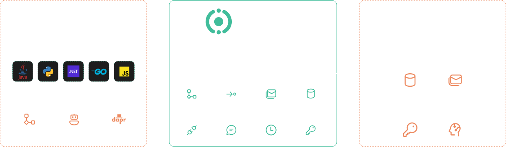
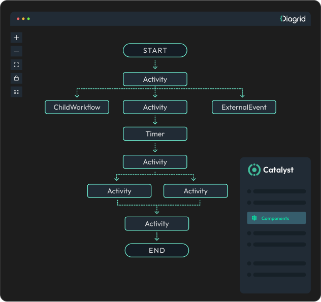

## 1. What is Diagrid?

Diagrid is the enterprise platform for workflow orchestration, service discovery, and pub/sub, powered by Dapr. It provides a centralized control plane to manage Dapr applications and workflows across multiple environments, including Kubernetes, VMs, serverless, bare metal, and hybrid environments. This theoretic challenge takes about 2 minutes to complete.

## 2. Why Use Diagrid?

Since Diagrid is compatible with Dapr you can use Diagrid to quickly build and run Dapr applications, including durable workflows and agentic systems. Many enterprise organizations already use Dapr to speed up their development of cloud-native applications. What Diagrid offers on top of that is the ability to centrally manage and govern Dapr applications across multiple teams and environments. It also offers essential workflow visualization and debugging capabilities that are not available in Dapr.

## 3. Diagrid features

- **Centralized Dapr APIs, distributed workflows**: Deploy applications and workflows that span across Kubernetes, VMs, serverless, bare metal, and hybrid environments. Call Dapr APIs from any compute. Implement workflows with durable timers, child workflows, human-in-the-loop scenarios, and more.
- **Bring governance to your projects**: Use projects to enforce proper team ownership, track and audit operations and give access control across all your applications.
- **Optimized workflow engine performance**: Execute long-running, stateful processes reliably without managing infrastructure concerns or scaling. Scale from zero to your highest throughput demands. 
- **Orchestrate long-lived agents with memory**: Out-of-the-box durability for AI-powered applications running anywhere with immediate insight into your agent’s actions, memory, tool calls with visibility into each stage of the agent’s workflow.

---

Now that you know what Diagrid is and why organizations use it, let's continue to the next challenge where you'll create a free Diagrid account, install the Diagrid CLI, and login to your Diagrid account using the Diagrid CLI.
