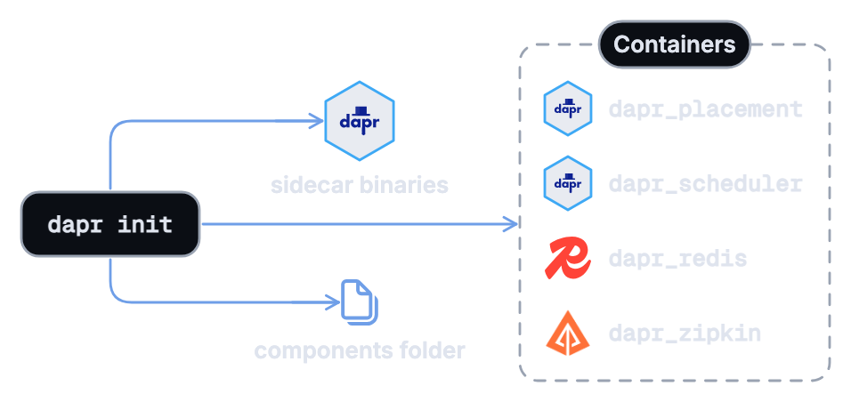

# The Dapr CLI

The Dapr CLI is used during local development to:
- Run your applications with a Dapr sidecar.
- Review the Dapr sidecar logs.
- List running services.

The sandbox already has the Dapr CLI installed, and `dapr init` already ran when the sandbox started. In this lab, you'll check both. This hands-on lab takes about 3 minutes to complete.

## 1. The Dapr CLI

> [!IMPORTANT]
> When you use the *Run* button on a command, select the matching terminal from the dropdown that appears.

Use the **Dapr CLI** window to check that the Dapr CLI is installed:

```bash,run
dapr -h
```

The expected output should be:

```text,nocopy
          __
     ____/ /___ _____  _____
    / __  / __ '/ __ \/ ___/
   / /_/ / /_/ / /_/ / /
   \__,_/\__,_/ .___/_/
             /_/

===============================
Distributed Application Runtime

Usage:
  dapr [flags]
  dapr [command]
...
```

As you can see in the output, the Dapr CLI can be used for many things, some commands are only available in self-hosted mode, and others for running Dapr with Kubernetes. You can read more about the Dapr CLI commands in the [Dapr docs](https://docs.dapr.io/reference/cli/). In this lab you'll use `version`, and in the next labs you'll frequently use the `run` command.

## 2. What `dapr init` did

Dapr runs as a sidecar alongside your application. In self-hosted mode, this means Dapr runs as a process on your local machine. The Dapr CLI by itself is not the Dapr sidecar that runs next to your application. The sidecar is installed locally by the CLI command `dapr init`, which ran when the sandbox started. When `dapr init` ran, it:
- Fetched and installed the Dapr sidecar binaries locally.
- Created a development environment that streamlines application development with Dapr.

Dapr initialization included:
- Running a Redis container instance to be used as a local state store and message broker.
- Running a Zipkin container instance for observability.
- Creating a default components folder with component definitions for the above.
- Running a Dapr placement service container instance for local actor support.
- Running a Dapr scheduler service container instance for job scheduling.



On your own machine, you run `dapr init` once, after you install the Dapr CLI.

## 3. Verify the Dapr version

To verify both the Dapr CLI and the Dapr runtime, run:

```bash,run
dapr --version
```

The expected output should be:

```text,nocopy
CLI version: 1.19.1
Runtime version: 1.19.2
```

## 4. Verify the containers

Verify that the Dapr containers are running:

```bash,run
docker ps --format {{.Names}}
```

The expected output should be 4 running containers:
- `dapr_placement`: Used to manage the location for Dapr Actors.
- `dapr_scheduler`: Used by Dapr Actors & the Jobs API.
- `dapr_redis`: The default State Management & Pub/Sub component when running Dapr in self-hosted mode.
- `dapr_zipkin`: The default tracing dashboard when running Dapr in self-hosted mode.

---

The Dapr CLI is installed, and Dapr is initialized in self-hosted mode. The local environment is ready for development.

## What's next?

In the next lab you'll use the State Management API: you'll start a Dapr sidecar with the CLI, save a value and read it back.
