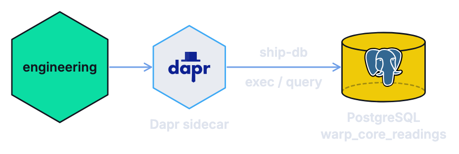

# PostgreSQL output binding

In this lab, you'll let an app store, query and purge rows in PostgreSQL through an output binding, with nothing but SQL and a component name in the code. This hands-on lab takes about 8 minutes to complete.

## Before you start

The terminals, and the applications running in them, stay as they are when you move between labs. Open the **Dev Dashboard** tab and look at which applications are running. If any are, for example `engineering` from the previous lab, use the **Dapr CLI** window to stop them by pressing `Ctrl+C`. They use the same ports as the apps in this lab. Then go back to the **Editor** tab.

## 1. Where the database comes from

> [!IMPORTANT]
> When you use the *Run* button on a command, select the matching terminal from the dropdown that appears.

The sandbox started a PostgreSQL container for you when it booted, with this command:

```text,nocopy
docker run -d --name bindings-postgres -p 127.0.0.1:5432:5432 \
  -e POSTGRES_USER=dapr -e POSTGRES_PASSWORD=dapr -e POSTGRES_DB=dapr \
  -v /root/university-labs/bindings/sql:/docker-entrypoint-initdb.d:ro \
  postgres:18.7
```

The user, the password and the database are all `dapr`, and the port is only reachable from inside the sandbox. The script in `bindings/sql/init.sql` ran on the first start and created two tables. Use the **curl** window to list them:

```bash,run
docker exec bindings-postgres psql -U dapr -d dapr -c "\dt"
```

Expected output:

```text,nocopy
               List of tables
 Schema |        Name        | Type  | Owner
--------+--------------------+-------+-------
 public | comms_log          | table | dapr
 public | warp_core_readings | table | dapr
(2 rows)
```

This lab uses `warp_core_readings`, and the last lab uses `comms_log`.

> [!NOTE]
> The commands in this track run one SQL statement with `psql -c` and return. To explore the database yourself, open an interactive session with `docker exec -it bindings-postgres psql -U dapr -d dapr` and leave it with `\q`.

### If the database is not running

If the command above answers `No such container: bindings-postgres`, use the **curl** window to start the database again. The block removes an existing container first, so it is safe to run more than once. It waits until the tables exist and then lists them, so you see the same two tables as above; if it prints an error instead, run it again. A running demo app reconnects by itself once the database is back:

```bash,run
docker rm -f bindings-postgres >/dev/null 2>&1 || true
docker run -d --name bindings-postgres -p 127.0.0.1:5432:5432 \
  -e POSTGRES_USER=dapr -e POSTGRES_PASSWORD=dapr -e POSTGRES_DB=dapr \
  -v /root/university-labs/bindings/sql:/docker-entrypoint-initdb.d:ro \
  postgres:18.7
for _ in $(seq 1 60); do
  docker exec bindings-postgres psql -h 127.0.0.1 -U dapr -d dapr -tAc 'SELECT 1 FROM comms_log' >/dev/null 2>&1 && break
  sleep 1
done
docker exec bindings-postgres psql -U dapr -d dapr -c "\dt"
```

## 2. The output binding component

Use the **Editor** tab and open the `resources` folder of your language, one level above the demo folders: `dotnet/resources`, `python/resources` or `java/resources`. Open `ship-db.yaml`:

```yaml,nocopy
apiVersion: dapr.io/v1alpha1
kind: Component
metadata:
  name: ship-db
spec:
  type: bindings.postgresql
  version: v1
  metadata:
  - name: connectionString
    value: "host=localhost port=5432 user=dapr password=dapr dbname=dapr sslmode=disable"
  - name: direction
    value: output
```



The component is a binding of type `bindings.postgresql` named `ship-db`, with `direction: output`: the app calls Dapr, and Dapr calls the database. The PostgreSQL binding only works in this direction, which is why the schedule still comes from a cron binding.

> [!NOTE]
> The connection string holds a password in plain text, which is fine for a local demo container. The Dapr Secrets track shows how to read it from a secret store with `secretKeyRef` instead.

Now open the demo folder of your language: `dotnet/Demo2-PostgresOutput`, `python/demo2-postgres-output` or `java/demo2-postgres-output`. Its `dapr.yaml` loads two folders of components:

```yaml,nocopy
common:
  resourcesPaths:
    - ../resources
    - ./resources
```

`../resources` is the shared folder with `ship-db`, which all the later demos use too. `./resources` holds this demo's own components: the `warp-core-scan` cron binding from the previous lab and a second cron binding, `purge-old-readings`, which calls the app every 30 seconds.

Open the code that calls the binding.

<details>
   <summary><b>.NET</b></summary>

Open `ShipDb.cs` in the `dotnet/Demo2-PostgresOutput/Engineering` folder. `ExecAsync` and `QueryAsync` build a binding request for the component `ship-db` with the operation `exec` or `query`, put the SQL in the request metadata and send it with `daprClient.InvokeBindingAsync`. `Program.cs` calls them from the `/warp-core-scan`, `/purge-old-readings` and `/readings` endpoints.

</details>

<details>
   <summary><b>Python</b></summary>

Open `app.py` in the `python/demo2-postgres-output/engineering` folder. The `ShipDb` class has an `exec` and a `query` method, which call `invoke_binding` on the Dapr client with the component `ship-db`, the operation, and the SQL in the binding metadata. The `/warp-core-scan`, `/purge-old-readings` and `/readings` endpoints use them.

</details>

<details>
   <summary><b>Java</b></summary>

Open `ShipDb.java` in the `java/demo2-postgres-output/engineering/src/main/java/io/diagrid/university/bindings/engineering` folder. `exec` and `query` build a binding request for the component `ship-db` with the operation, put the SQL in the request metadata and send it with `daprClient.invokeBinding`. `ReadingController.java` calls them from the `/warp-core-scan`, `/purge-old-readings` and `/readings` endpoints.

</details>

The binding has two operations. `exec` runs a statement that changes data and returns no rows, such as `INSERT` or `DELETE`. `query` runs a `SELECT` and returns the rows. The SQL travels in the request metadata: `sql` holds the statement with `$1`, `$2` placeholders, and `params` holds the values as a JSON array in a string, such as `"[900]"`. The app never loads a PostgreSQL driver and never mentions PostgreSQL, only the name `ship-db`.

## 3. Run the demo

Use the **Dapr CLI** window to go to the `bindings` folder first. The terminal stays in whatever folder it was in when you move between labs, so this makes sure the commands below start from the right place:

```bash,run
cd /root/university-labs/bindings
```

> [!IMPORTANT]
> Run `dapr run -f .` from inside the demo folder of your language: `Demo2-PostgresOutput` for .NET, `demo2-postgres-output` for Python and Java. The `resourcesPaths` in `dapr.yaml` are relative to that folder.

<details>
   <summary><b>.NET</b></summary>

Use the **Dapr CLI** window to run the commands.

Navigate to the *dotnet/Demo2-PostgresOutput* folder:

```bash,run
cd dotnet/Demo2-PostgresOutput
```

Run the application using the Dapr CLI:

```bash,run
dapr run -f .
```

</details>

<details>
   <summary><b>Python</b></summary>

Use the **Dapr CLI** window to run the commands.

Navigate to the *python/demo2-postgres-output* folder:

```bash,run
cd python/demo2-postgres-output
```

Run the application using the Dapr CLI:

```bash,run
dapr run -f .
```

</details>

<details>
   <summary><b>Java</b></summary>

Use the **Dapr CLI** window to run the commands.

Navigate to the *java/demo2-postgres-output* folder:

```bash,run
cd java/demo2-postgres-output
```

Run the application using the Dapr CLI:

```bash,run
dapr run -f .
```

</details>

###

> [!IMPORTANT]
> Wait until the application is running before continuing. The Java application can take a little longer to start.
>
> Open the **Dev Dashboard** tab and check the application health on the **Applications** page: `engineering` is ready when the **Health** column shows a green dot. You can also inspect the output of the **Dapr CLI** window.

The **Dapr CLI** window should show this line when the sidecar has started. The gRPC port can differ, and your application's logs follow:

```text,nocopy
ℹ️  Started Dapr with app id "engineering". HTTP Port: 3520. gRPC Port: 35935
```

## 4. Store and read readings

On the **Logs** page of the **Dev Dashboard** tab, select `engineering` and search for `engineering`. The readings in your log will differ:

```text,nocopy
== APP - engineering == engineering cleared warp_core_readings for a fresh run
== APP - engineering == engineering warp-core scan wc-0001 stardate=85737.4 coreTempK=911 plasmaFlow=0.76
== APP - engineering == engineering stored reading wc-0001 in warp_core_readings
== APP - engineering == engineering warp-core scan wc-0002 stardate=85737.4 coreTempK=902 plasmaFlow=0.95
== APP - engineering == engineering stored reading wc-0002 in warp_core_readings
```

At startup the app empties `warp_core_readings` with one `exec`, so rows from an earlier run don't mix with yours. Then each tick of the cron binding creates a reading and stores it with another `exec`, an `INSERT`.

Wait for a few readings, then use the **curl** window to ask the app for the hot ones. The app reads them with a `query`:

```bash,run
curl -s "http://localhost:5201/readings?minTemp=900" | jq
```

Expected output, newest first. Your values will differ, and the list is empty if no reading has reached 900 K yet:

```json,nocopy
[
  {
    "readingId": "wc-0004",
    "stardate": 85737.4,
    "coreTempK": 922,
    "plasmaFlow": 0.92,
    "recordedAt": "2026-11-19T09:25:49Z"
  },
  {
    "readingId": "wc-0003",
    "stardate": 85737.4,
    "coreTempK": 919,
    "plasmaFlow": 0.94,
    "recordedAt": "2026-11-19T09:25:39Z"
  }
]
```

Look at the same rows in the database itself, with the **curl** window:

```bash,run
docker exec bindings-postgres psql -U dapr -d dapr -c "SELECT * FROM warp_core_readings;"
```

Expected output. Your values will differ:

```text,nocopy
 reading_id | stardate | core_temp_k | plasma_flow |          recorded_at
------------+----------+-------------+-------------+-------------------------------
 wc-0001    |  85737.4 |         911 |        0.76 | 2026-11-19 09:25:19.779282+00
 wc-0002    |  85737.4 |         902 |        0.95 | 2026-11-19 09:25:29.733568+00
 wc-0003    |  85737.4 |         919 |        0.94 | 2026-11-19 09:25:39.772748+00
 wc-0004    |  85737.4 |         922 |        0.92 | 2026-11-19 09:25:49.781023+00
(4 rows)
```

The table has the columns the app's SQL chose. Dapr passed the statements through and added nothing of its own.

## 5. What a query returns

The binding answers a `query` with an array of arrays: one inner array per row, with the values in the order of the `SELECT` list and no column names. For one reading it looks like this:

```json,nocopy
[["wc-0004",85737.4,922,0.92,"2026-11-19T09:25:49Z"]]
```

Open the `/readings` handler for your language again (`Program.cs`, `app.py` or `ReadingController.java`) and find where it turns each row into a reading: it reads the values by position, the first one as the reading ID, the second as the stardate, and so on. The SQL casts `stardate` and `plasma_flow` to `float8` and formats `recorded_at` as text, so every value arrives as a plain JSON number or string.

This is the price of a binding: it hands you the database's answer with very little help. In return the app needs no database driver, and the connection details live in one YAML file.

## 6. Purge old readings

Every 30 seconds the `purge-old-readings` cron binding calls the app, and the app runs an `exec` with `DELETE FROM warp_core_readings WHERE recorded_at < now() - interval '1 minute'`. On the **Logs** page of the **Dev Dashboard** tab, search for `purged`:

```text,nocopy
== APP - engineering == engineering purged old readings
```

A reading is purged at the first tick after it is a minute old, so the oldest rows go about a minute and a half after you started the app. When a `purged old readings` line appears after that, use the **curl** window to run the same `SELECT` again:

```bash,run
docker exec bindings-postgres psql -U dapr -d dapr -c "SELECT * FROM warp_core_readings;"
```

The oldest readings are gone, and new ones have arrived. Two input bindings drive the app, one output binding reaches the database, and the app never schedules or connects anything itself.

## 7. Stop the applications

Use the **Dapr CLI** window to stop the application by pressing `Ctrl+C`.

---

The app stored, queried and purged rows in PostgreSQL through an output binding, with the `exec` and `query` operations.

## What's next?

In the next lab you'll save each reading twice into the same database: once through the State API and once through the binding. Then you'll compare the two tables and decide when to use which.
