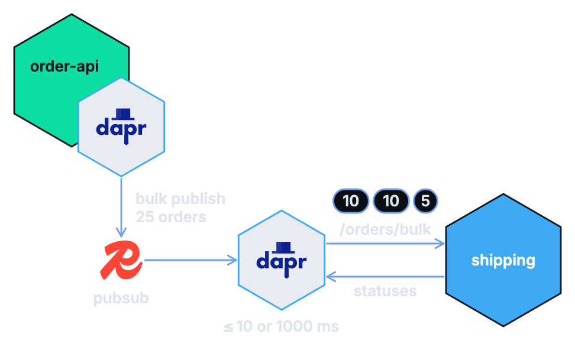

# Bulk messages

In this lab, you'll publish 25 orders in one call and watch `shipping` receive them in batches, then answer a batch by hand to see the status per entry. This hands-on lab takes about 7 minutes to complete.

## Before you start

The terminals, and the applications running in them, stay as they are when you move between labs. Open the **Dev Dashboard** tab and look at which applications are running. If any are, for example `order-api` and `shipping` from the previous lab, use the **Dapr CLI** window to stop them by pressing `Ctrl+C`. Then go back to the **Editor** tab.

## 1. Bulk publish and bulk subscribe

Until now, every message travelled alone: one publish call, one delivery. Dapr can also send many messages in one go. **Bulk publish** sends a list of messages to the broker in one call. **Bulk subscribe** collects messages on the subscriber side and delivers them to the app in one request.

Use the **Editor** tab and open the demo folder of your language: `dotnet/Demo4-Bulk`, `python/demo4-bulk` or `java/demo4-bulk`. It holds two apps, each with its own Dapr sidecar:

- `order-api` listens on port 5101. Its `/orders/bulk` endpoint publishes many orders to the topic `orders` with one bulk publish call.
- `shipping` listens on port 5102 and has one route, `/orders/bulk`, which receives a batch of orders in one request.

Open the code of both apps for your language.

<details>
   <summary><b>.NET</b></summary>

Open `Program.cs` in the `dotnet/Demo4-Bulk/OrderApi` folder. The `/orders/bulk` endpoint builds a list of orders and publishes it with `BulkPublishEventAsync`.

Open `Program.cs` in the `dotnet/Demo4-Bulk/Shipping` folder. The `/orders/bulk` endpoint loops over the `entries` of the request and builds one status for each.

</details>

<details>
   <summary><b>Python</b></summary>

Open `app.py` in the `python/demo4-bulk/order-api` folder. The `/orders/bulk` endpoint builds a list of orders and publishes it with a bulk publish call.

Open `app.py` in the `python/demo4-bulk/shipping` folder. The `/orders/bulk` endpoint loops over the `entries` of the request and builds one status for each.

</details>

<details>
   <summary><b>Java</b></summary>

Open `OrderController.java` in the `java/demo4-bulk/order-api/src/main/java/io/diagrid/university/pubsub/orderapi` folder. The `/orders/bulk` endpoint builds a list of orders and publishes it with a bulk publish call.

Open `OrderController.java` in the `java/demo4-bulk/shipping/src/main/java/io/diagrid/university/pubsub/shipping` folder. The `/orders/bulk` endpoint loops over the `entries` of the request and builds one status for each.

</details>

Bulk subscribe is not switched on in the code. It is a setting of the subscription. Open `subscription-bulk.yaml` in the `resources` folder of the demo:

```yaml,nocopy
spec:
  pubsubname: pubsub
  topic: orders
  routes:
    default: /orders/bulk
  bulkSubscribe:
    enabled: true
    maxMessagesCount: 10
    maxAwaitDurationMs: 1000
scopes:
  - shipping
```

With `bulkSubscribe`, Dapr holds messages back and sends them as one request. A batch goes out when it holds `maxMessagesCount` messages (10 here) or when `maxAwaitDurationMs` (1000 ms) has passed since the batch started filling, whichever comes first. As in the earlier labs, `scopes` sits beside `spec`, so only `shipping` loads the subscription.



## 2. Run the demo

> [!IMPORTANT]
> When you use the *Run* button on a command, select the matching terminal from the dropdown that appears.

Use the **Dapr CLI** window to go to the `pubsub` folder first. The terminal stays in whatever folder it was in when you move between labs, so this makes sure the commands below start from the right place:

```bash,run
cd /root/university-labs/pubsub
```

> [!IMPORTANT]
> Run `dapr run -f .` from inside the demo folder of your language: `Demo4-Bulk` for .NET, `demo4-bulk` for Python and Java. The `resourcesPaths` in `dapr.yaml` are relative to that folder.

<details>
   <summary><b>.NET</b></summary>

Use the **Dapr CLI** window to run the commands.

Navigate to the *dotnet/Demo4-Bulk* folder:

```bash,run
cd dotnet/Demo4-Bulk
```

Run the two applications using the Dapr CLI:

```bash,run
dapr run -f .
```

</details>

<details>
   <summary><b>Python</b></summary>

Use the **Dapr CLI** window to run the commands.

Navigate to the *python/demo4-bulk* folder:

```bash,run
cd python/demo4-bulk
```

Run the two applications using the Dapr CLI:

```bash,run
dapr run -f .
```

</details>

<details>
   <summary><b>Java</b></summary>

Use the **Dapr CLI** window to run the commands.

Navigate to the *java/demo4-bulk* folder:

```bash,run
cd java/demo4-bulk
```

Run the two applications using the Dapr CLI:

```bash,run
dapr run -f .
```

</details>

###

> [!IMPORTANT]
> Wait until both applications are running before continuing. The Java applications can take a little longer to start.
>
> Open the **Dev Dashboard** tab and check the application health on the **Applications** page: `order-api` and `shipping` are ready when the **Health** column shows a green dot. You can also inspect the output of the **Dapr CLI** window.

The **Dapr CLI** window should show these lines when the sidecars have started. The port numbers can differ, and your applications' logs follow:

```text,nocopy
ℹ️  Started Dapr with app id "order-api". HTTP Port: 3510. gRPC Port: 35935
ℹ️  Started Dapr with app id "shipping". HTTP Port: 3511. gRPC Port: 39745
```

## 3. Publish 25 orders in one call

Use the **curl** window to ask `order-api` for 25 orders named `bulk-1` to `bulk-25`:

```bash,run
curl -s -X POST 'http://localhost:5101/orders/bulk?count=25&prefix=bulk' | jq
```

Expected output:

```json,nocopy
{
  "sent": 25,
  "failed": 0
}
```

The `count` must be a whole number from 1 to 100, written in plain digits. Anything else is answered with `400` and `{"error": "INVALID_COUNT"}`. A bulk publish can succeed for some messages and fail for others, which is why the answer reports both `sent` and `failed`.

## 4. Look at the batches

Open the **Dev Dashboard** tab, go to the **Logs** page, select `shipping` in the application drop-down and type `batch` in the search bar. `shipping` received the 25 orders in a few requests instead of 25. With Redis you will typically see batches of 10, 10 and 5. The order inside a batch is not the order in which the orders were published. As on the earlier labs, the real lines also carry the logger prefix of your language after `== APP - shipping ==`:

```text,nocopy
== APP - shipping == shipping received batch of 10 orders: bulk-23,bulk-1,bulk-20,...
== APP - shipping == shipping received batch of 10 orders: ...
== APP - shipping == shipping received batch of 5 orders: ...
```

Two batches were full, so they went out at once. The last 5 orders waited until `maxAwaitDurationMs` ran out. Your sizes can differ a little with timing, but no batch holds more than 10 orders.

## 5. One status per entry

A batch can hold good and bad messages. So `shipping` does not answer a batch with one status, it answers with a status per entry, and Dapr redelivers only the entries that did not succeed. The statuses are `SUCCESS`, `RETRY` and `DROP`.

You can see this by posting a hand-made batch straight to `shipping`, without the sidecar. Entry `e1` is a complete CloudEvent. Entry `e2` is not one:

```bash,run
curl -s -X POST http://localhost:5102/orders/bulk -H 'Content-Type: application/json' \
  -d '{"entries":[{"entryId":"e1","event":{"data":{"orderId":"o-4001","item":"coffee-beans","quantity":1,"priority":"standard"},"datacontenttype":"application/json","id":"e1-event","source":"curl","specversion":"1.0","type":"com.dapr.event.sent"},"contentType":"application/cloudevents+json"},{"entryId":"e2","event":{"nothing":"here"},"contentType":"application/cloudevents+json"}],"topic":"orders"}' | jq
```

Expected output:

```json,nocopy
{
  "statuses": [
    {
      "entryId": "e1",
      "status": "SUCCESS"
    },
    {
      "entryId": "e2",
      "status": "DROP"
    }
  ]
}
```

`shipping` read `e1` with the CloudEvents SDK and answered `SUCCESS`. It could not read `e2`, so it answered `DROP` and logged `shipping dropped unreadable entry e2`. Search the `shipping` log on the **Logs** page for `entry e2` to see it. `DROP` tells Dapr to stop trying for that entry. Had the handler answered one status for the whole batch, a single bad entry would have made Dapr deliver all 10 again, including the 9 that were fine.

## 6. Stop the applications

Use the **Dapr CLI** window to stop the applications by pressing `Ctrl+C`.

---

You published 25 orders in one call, received them in batches, and saw that a batch is answered per entry.

## What's next?

In the next lab you'll route orders to different endpoints based on their content, and send an order that keeps failing to a dead-letter topic.
