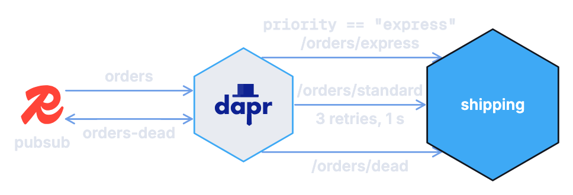

# Routing and dead letters

In this lab, you'll route orders to different endpoints based on their content, and send an order that keeps failing until Dapr moves it to a dead-letter topic. This hands-on lab takes about 7 minutes to complete.

## Before you start

The terminals, and the applications running in them, stay as they are when you move between labs. Open the **Dev Dashboard** tab and look at which applications are running. If any are, for example `order-api` and `shipping` from the previous lab, use the **Dapr CLI** window to stop them by pressing `Ctrl+C`. Then go back to the **Editor** tab.

## 1. Routes and a dead-letter topic

So far, `shipping` received every order on one route. A subscription can also pick the route from the content of the message, and it can say where a message goes when the app keeps failing to process it.

Use the **Editor** tab and open the demo folder of your language: `dotnet/Demo5-RoutingDeadLetter`, `python/demo5-routing-dead-letter` or `java/demo5-routing-dead-letter`. It holds two apps, each with its own Dapr sidecar:

- `order-api` listens on port 5101 and publishes the orders you send it to the topic `orders`.
- `shipping` listens on port 5102 and has three routes: `/orders/express`, `/orders/standard` and `/orders/dead`.

Open the code of `shipping` for your language.

<details>
   <summary><b>.NET</b></summary>

Open `Program.cs` in the `dotnet/Demo5-RoutingDeadLetter/Shipping` folder.

</details>

<details>
   <summary><b>Python</b></summary>

Open `app.py` in the `python/demo5-routing-dead-letter/shipping` folder.

</details>

<details>
   <summary><b>Java</b></summary>

Open `OrderController.java` in the `java/demo5-routing-dead-letter/shipping/src/main/java/io/diagrid/university/pubsub/shipping` folder.

</details>

Each route is a plain endpoint that logs the order. The code does not decide which one gets an order. The subscription does. Open `subscription-orders.yaml` in the `resources` folder of the demo:

```yaml,nocopy
spec:
  pubsubname: pubsub
  topic: orders
  routes:
    rules:
      - match: 'event.data.priority == "express"'
        path: /orders/express
    default: /orders/standard
  deadLetterTopic: orders-dead
scopes:
  - shipping
```

Under `routes`, `rules` are checked in order. The first rule whose `match` expression is true picks the `path`. The expression is written in CEL and sees the CloudEvent as `event`, so `event.data.priority` is the `priority` of the order. A message that matches no rule goes to the `default` route. `deadLetterTopic` names the topic where Dapr republishes a message that could not be delivered.

The dead-letter topic is an ordinary topic. Open `subscription-dead-letter.yaml` in the same folder:

```yaml,nocopy
spec:
  pubsubname: pubsub
  topic: orders-dead
  routes:
    default: /orders/dead
scopes:
  - shipping
```

`shipping` subscribes to `orders-dead` like any other topic, and its `/orders/dead` route receives what ended up there.

## 2. Retries

Dapr only dead-letters a message after it gave up on it. How long it keeps trying is set in a resiliency policy. Open `resiliency.yaml` in the same folder:

```yaml,nocopy
spec:
  policies:
    retries:
      orderRetries:
        policy: constant
        duration: 1s
        maxRetries: 3
  targets:
    components:
      pubsub:
        inbound:
          retry: orderRetries
scopes:
  - shipping
```

The policy is a constant 1 second between tries, with at most 3 retries. The target is the `inbound` side of the component `pubsub`: it applies to messages Dapr delivers to an app. A message is delivered once, and retried 3 times when the app answers with a failure. That makes 4 deliveries, then Dapr dead-letters it.

In the code of `shipping`, find the order with the item `poison`. The handler answers `500` with `{"status": "RETRY"}` for it. A `RETRY` answer asks Dapr to deliver the message again. The demo does not use `DROP` here, because `DROP` tells Dapr to give up at once and skips the retries, and the retries are what this lab is about.



## 3. Run the demo

> [!IMPORTANT]
> When you use the *Run* button on a command, select the matching terminal from the dropdown that appears.

Use the **Dapr CLI** window to go to the `pubsub` folder first. The terminal stays in whatever folder it was in when you move between labs, so this makes sure the commands below start from the right place:

```bash,run
cd /root/university-labs/pubsub
```

> [!IMPORTANT]
> Run `dapr run -f .` from inside the demo folder of your language: `Demo5-RoutingDeadLetter` for .NET, `demo5-routing-dead-letter` for Python and Java. The `resourcesPaths` in `dapr.yaml` are relative to that folder.

<details>
   <summary><b>.NET</b></summary>

Use the **Dapr CLI** window to run the commands.

Navigate to the *dotnet/Demo5-RoutingDeadLetter* folder:

```bash,run
cd dotnet/Demo5-RoutingDeadLetter
```

Run the two applications using the Dapr CLI:

```bash,run
dapr run -f .
```

</details>

<details>
   <summary><b>Python</b></summary>

Use the **Dapr CLI** window to run the commands.

Navigate to the *python/demo5-routing-dead-letter* folder:

```bash,run
cd python/demo5-routing-dead-letter
```

Run the two applications using the Dapr CLI:

```bash,run
dapr run -f .
```

</details>

<details>
   <summary><b>Java</b></summary>

Use the **Dapr CLI** window to run the commands.

Navigate to the *java/demo5-routing-dead-letter* folder:

```bash,run
cd java/demo5-routing-dead-letter
```

Run the two applications using the Dapr CLI:

```bash,run
dapr run -f .
```

</details>

###

> [!IMPORTANT]
> Wait until both applications are running before continuing. The Java applications can take a little longer to start.
>
> Open the **Dev Dashboard** tab and check the application health on the **Applications** page: `order-api` and `shipping` are ready when the **Health** column shows a green dot. You can also inspect the output of the **Dapr CLI** window.

The **Dapr CLI** window should show these lines when the sidecars have started. The port numbers can differ, and your applications' logs follow:

```text,nocopy
ℹ️  Started Dapr with app id "order-api". HTTP Port: 3510. gRPC Port: 35935
ℹ️  Started Dapr with app id "shipping". HTTP Port: 3511. gRPC Port: 39745
```

## 4. Send three orders

Use the **curl** window to send three orders: a standard one, an express one and the poison one:

```bash,run
for o in \
  '{"orderId":"o-5001","item":"coffee-beans","quantity":1,"priority":"standard"}' \
  '{"orderId":"o-5002","item":"coffee-beans","quantity":1,"priority":"express"}' \
  '{"orderId":"o-5003","item":"poison","quantity":1,"priority":"standard"}'; do
  curl -s -X POST http://localhost:5101/orders -H 'Content-Type: application/json' -d "$o" | jq
done
```

Expected output:

```json,nocopy
{
  "orderId": "o-5001",
  "topic": "orders"
}
{
  "orderId": "o-5002",
  "topic": "orders"
}
{
  "orderId": "o-5003",
  "topic": "orders"
}
```

## 5. Read the log

Open the **Dev Dashboard** tab, go to the **Logs** page, select `shipping` in the application drop-down and type `order o-50` in the search bar. `shipping` logs the routing first, then the retries of the poison order, then its arrival on `orders-dead`. Wait a few seconds for the last line:

```text,nocopy
== APP - shipping == shipping standard order o-5001
== APP - shipping == shipping express order o-5002
== APP - shipping == shipping rejected order o-5003
== APP - shipping == shipping rejected order o-5003
== APP - shipping == shipping rejected order o-5003
== APP - shipping == shipping rejected order o-5003
== APP - shipping == shipping dead-lettered order o-5003
```

Here is what happened:

- `o-5001` has the priority `standard`, matches no rule and goes to the default route `/orders/standard`.
- `o-5002` has the priority `express`, matches the rule and goes to `/orders/express`.
- (1) `o-5003` is routed to `/orders/standard`, where `shipping` rejects it with `500` and `RETRY`. Dapr delivered it 4 times: the first try plus the 3 retries from `resiliency.yaml`, one second apart.
- (2) After the last retry, Dapr republished `o-5003` to `orders-dead`. (3) `shipping` received it there on `/orders/dead`.

The good orders were never dead-lettered. The order of the lines can differ a little from this list, because the three orders are delivered independently.

## 6. Stop the applications

Use the **Dapr CLI** window to stop the applications by pressing `Ctrl+C`.

---

You routed orders by their content, watched a failing order get retried 3 times, and saw it arrive on the dead-letter topic.

## What's next?

In the next lab you'll swap Redis for RabbitMQ without touching the apps, and see what Dapr creates in the broker for these same three orders.
