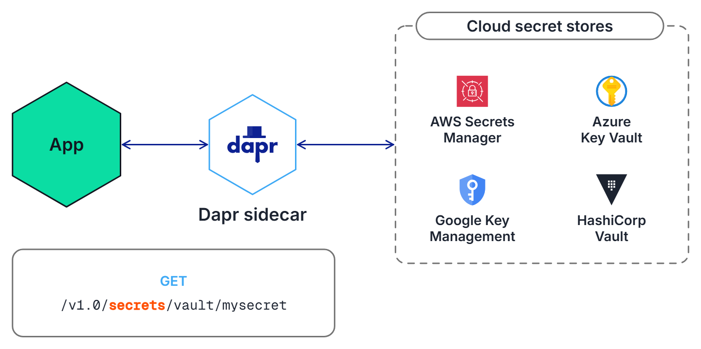

# What is the Secrets API

In this lab, you'll run an application that reads a secret through the Dapr Secrets API, it will take about 5 minutes to complete.

## 1. Why a secret store?

The `order-api` application in this lab needs a password store. It could read it from a config file or an environment variable, but then the password sits in plain text next to the code, in the deployment settings, and probably in a git history.

With the Dapr Secrets API the application only asks the Dapr sidecar for a secret *by name*.



Where that secret really lives is configured in a Dapr component. In this lab the component is the simplest one: a local file store that reads a `secrets.json` file.

The `secrets.json` file in the `secrets` folder contains two fake secrets: `orderdb-password` and `payments-api-key`.

## 2. Inspect the application

Use the **Editor** tab and open the demo for your language. Each language tab below contains the same application: an HTTP endpoint `GET /secret/{name}` that asks Dapr for the secret with that name and returns it.

> [!NOTE]
> Expand the language-specific instructions to inspect the application.

<details>
   <summary><b>.NET</b></summary>

Open the `Program.cs` file in the `dotnet/Demo1-ReadSecret` folder. The `/secret/{name}` endpoint calls `daprClient.GetSecretAsync("secretstore", name)`.

</details>

<details>
   <summary><b>Python</b></summary>

Open the `app.py` file in the `python/Demo1-ReadSecret` folder. The `/secret/{name}` endpoint calls `client.get_secret(store_name="secretstore", key=name)`.

</details>

<details>
   <summary><b>Java</b></summary>

Open the `SecretController.java` file in the `java/Demo1-ReadSecret/src/main/java/io/diagrid/university/secrets` folder. The `/secret/{name}` endpoint calls `daprClient.getSecret("secretstore", name)`.

</details>

Notice that the code only contains the name of the secret store, `secretstore`. There is no file path, no password and no connection string.

The secret store itself is defined in the `secretstore-local.yaml` file in the `resources` folder of your language (for example `dotnet/resources`). Open it and look at the `type` and the `secretsFile`. The component is named `secretstore`, which is how the application refers to it.

## 3. Run the application

The `dapr.yaml` file in the demo folder is a Multi-App Run file. It starts the `order-api` application together with its Dapr sidecar and tells Dapr where to find the components.

Use the **Dapr CLI** window to go to the `secrets` folder first. The terminal stays in whatever folder it was in when you move between pages, so this makes sure the commands below start from the right place:

> [!IMPORTANT]
> When you use the *Run* button on a command, select the matching terminal from the dropdown that appears.

```bash,run
cd /root/ai-agent-tracks-instruqt/secrets
```

> [!IMPORTANT]
> Run `dapr run -f .` from inside the demo folder (`Demo1-ReadSecret` of your language). The `secretsFile` path in the component is relative to that folder, so running the command from anywhere else means the secret store cannot find `secrets.json`.

<details>
   <summary><b>.NET</b></summary>

Use the **Dapr CLI** window to run the commands.

Navigate to the *dotnet/Demo1-ReadSecret* folder:

```bash,run
cd dotnet/Demo1-ReadSecret
```

Run the application using the Dapr CLI:

```bash,run
dapr run -f .
```

</details>

<details>
   <summary><b>Python</b></summary>

Use the **Dapr CLI** window to run the commands.

Navigate to the *python/Demo1-ReadSecret* folder:

```bash,run
cd python/Demo1-ReadSecret
```

Run the application using the Dapr CLI:

```bash,run
dapr run -f .
```

</details>

<details>
   <summary><b>Java</b></summary>

Use the **Dapr CLI** window to run the commands.

Navigate to the *java/Demo1-ReadSecret* folder:

```bash,run
cd java/Demo1-ReadSecret
```

Run the application using the Dapr CLI:

```bash,run
dapr run -f .
```

</details>

###

> [!IMPORTANT]
> Inspect the output of the **Dapr CLI** window. Wait until the application is running before continuing. The Java application can take a little longer to start.
>
> You can also check the application status in the **Dev Dashboard** tab: go to the **Applications** page and select `order-api`.

The **Dapr CLI** window should show a line like this when the sidecar is started. The port number can differ, and your own application's logs follow:

```text,nocopy
ℹ️  Started Dapr with app id "order-api". HTTP Port: 3500. gRPC Port: 39945
```

## 4. Read a secret through the application

Use the **curl** window to ask the application for the `orderdb-password` secret:

```bash,run
curl -s http://localhost:5001/secret/orderdb-password | jq
```

Expected output:

```json,nocopy
{
  "name": "orderdb-password",
  "value": "s3cr3t-pa55w0rd"
}
```

## 5. Read a secret from the Dapr API directly

The application did not read `secrets.json` itself. It called the Dapr Secrets API of its sidecar, and you can do the same with curl. The sidecar listens on port 3500 and the `secretstore` component is part of the URL:

```bash,run
curl -s http://localhost:3500/v1.0/secrets/secretstore/orderdb-password | jq
```

Expected output:

```json,nocopy
{
  "orderdb-password": "s3cr3t-pa55w0rd"
}
```

This is the same API in every language, and it is the same API no matter which secret store sits behind the `secretstore` component.

## 6. Leave the application running

Do not stop the application. The **Dapr CLI** window and the application in it stay as they are when you move to the next page, and the next lab continues with this same application.

---

You've now read a secret through the Dapr Secrets API, from your application and from the sidecar directly.

## What's next?

In the next lab you'll take a closer look at the `secretstore` component, with the `order-api` application that is still running. You'll find out what each field of `secretstore-local.yaml` does, read all secrets with one call, let a Redis state store get its password from the secret store with `secretKeyRef`, and see how `nestedSeparator` and `multiValued` change the names of nested secrets.
