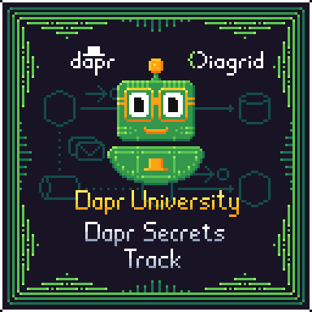

# Swap the provider

In this final lab, you'll swap the secret store from a local file to HashiCorp Vault, and run the same application against it. This hands-on lab takes about 7 minutes to complete. At the end of the lab, you can claim the Dapr University Holopin badge for this track.

## Before you start

The terminals, and the applications running in them, stay as they are when you move between pages. Open the **Dev Dashboard** tab and look at which applications are running. If any are, for example `app-a` and `app-b` from the previous lab, use the **Dapr CLI** window to stop them by pressing `Ctrl+C`. Then go back to the **Editor** tab.

## 1. One name, another store

The application asks Dapr for a secret store called `secretstore`. It has never known, and never will know, what is behind that name. So to swap the provider you don't touch the application. You change the YAML that defines `secretstore`.

Use the **Editor** tab and open the swap demo folder of your language: `dotnet/Demo3-SwapProvider`, `python/demo3-swap-provider` or `java/demo3-swap-provider`. It holds only configuration:

- `dapr.yaml`: open it. `appDirPath` points to the demo folder from labs 1 and 2 (`../Demo1-ReadSecret` in .NET, `../demo1-read-secret` in Python and Java), so it runs the very same application. It is not a copy. `resourcesPath` points to the `resources` folder next to it, which is the only difference with the `dapr.yaml` in that folder.
- `resources/secretstore-vault.yaml`: the new `secretstore`.
- `resources/statestore-with-secretref.yaml`: the state store component from lab 2, which takes its password from `secretstore`. You'll see what happens to it in step 5.

> [!NOTE]
> `secretstore-vault.yaml` is in a folder of its own because a Dapr sidecar refuses to start when two components have the same name. Next to `secretstore-local.yaml` it would be a second `secretstore`.

## 2. Compare the two components

Open `secretstore-vault.yaml` in `resources` and compare it with `secretstore-local.yaml` in the `resources` folder of your language (for example `dotnet/resources`):

```yaml,nocopy
metadata:
  name: secretstore
spec:
  type: secretstores.hashicorp.vault
  version: v1
  metadata:
  - name: vaultAddr
    value: http://localhost:8200
  - name: vaultToken
    value: root
```

- `metadata.name` is still `secretstore`. That's why the application does not change.
- `type` is now `secretstores.hashicorp.vault`. Only the implementation behind the name is different.
- `vaultAddr` and `vaultToken` replace `secretsFile`. The sandbox runs Vault in a container in dev mode, where the root token is `root`. Never put a token in a file like this for a real Vault.

The sandbox already stored your secrets in Vault, under the names Dapr expects (`secret/dapr/orderdb-password`, and so on). That is the work of the sandbox, not of the application. `legacy-api-key` is still not in the store, as in lab 3.

## 3. Run the same application against Vault

> [!IMPORTANT]
> When you use the *Run* button on a command, select the matching terminal from the dropdown that appears.

> [!IMPORTANT]
> Run `dapr run -f .` from inside the swap demo folder (`Demo3-SwapProvider` for .NET, `demo3-swap-provider` for Python and Java).

Use the **Dapr CLI** window to go to the `secrets` folder first. The terminal stays in whatever folder it was in when you move between pages, so this makes sure the commands below start from the right place:

```bash,run
cd /root/ai-agent-tracks-instruqt/secrets
```

The application is already built, so there is nothing you need to rebuild.

<details>
   <summary><b>.NET</b></summary>

Use the **Dapr CLI** window to run the commands.

Navigate to the *dotnet/Demo3-SwapProvider* folder:

```bash,run
cd dotnet/Demo3-SwapProvider
```

Run the application using the Dapr CLI:

```bash,run
dapr run -f .
```

</details>

<details>
   <summary><b>Python</b></summary>

Use the **Dapr CLI** window to run the commands.

Navigate to the *python/demo3-swap-provider* folder:

```bash,run
cd python/demo3-swap-provider
```

Run the application using the Dapr CLI:

```bash,run
dapr run -f .
```

</details>

<details>
   <summary><b>Java</b></summary>

Use the **Dapr CLI** window to run the commands.

Navigate to the *java/demo3-swap-provider* folder:

```bash,run
cd java/demo3-swap-provider
```

Run the application using the Dapr CLI:

```bash,run
dapr run -f .
```

</details>

###

> [!IMPORTANT]
> Wait until the application is running before continuing. The Java application can take a little longer to start.
>
> Open the **Dev Dashboard** tab and check the application health on the **Applications** page: `order-api` is ready when the **Health** column shows a green dot. You can also inspect the output of the **Dapr CLI** window.

The **Dapr CLI** window should show a line like this when the sidecar is started. The port number can differ, and your application's logs follow:

```text,nocopy
ℹ️  Started Dapr with app id "order-api". HTTP Port: 3500. gRPC Port: 39945
```

## 4. Ask for the secret, and find out where it came from

Use the **curl** window. This is the same request as in lab 1:

```bash,run
curl -s http://localhost:5001/secret/orderdb-password | jq
```

Expected output:

```json,nocopy
{
  "name": "orderdb-password",
  "value": "s3cr3t-pa55w0rd"
}
```

Same application, same request, same answer. Now ask the sidecar which type of component `secretstore` is:

```bash,run
curl -s http://localhost:3500/v1.0/metadata | jq '.components[] | select(.name == "secretstore") | {name, type}'
```

Expected output:

```json,nocopy
{
  "name": "secretstore",
  "type": "secretstores.hashicorp.vault"
}
```

The password came from Vault. You can prove it by adding a secret that only Vault has. It is not in `secrets.json`. This command stores a secret named `shipping-token` in Vault:

```bash,run
docker exec -e VAULT_ADDR=http://127.0.0.1:8200 -e VAULT_TOKEN=root vault vault kv put secret/dapr/shipping-token shipping-token=from-vault
```

The application reads it right away:

```bash,run
curl -s -w ' %{http_code}\n' http://localhost:5001/secret/shipping-token | jq
```

Expected output:

```json,nocopy
{
  "name": "shipping-token",
  "value": "from-vault"
}
200
```

The error contract did not change either. Ask for the secret that is in no store:

```bash,run
curl -s -w ' %{http_code}\n' http://localhost:5001/secret/legacy-api-key | jq
```

Expected output:

```json,nocopy
{
  "name": "legacy-api-key",
  "error": "INTERNAL"
}
500
```

A secret that does not exist is a 500, just as it was with the local file.

## 5. The state store follows

In lab 2, the state store component got its password from `secretstore` through a `secretKeyRef`. That component is in the folder too, and it did not change. Its reference is now answered by Vault. Use the **curl** window to save a value with a new key, `order-2`:

```bash,run
curl -s -X POST -H "Content-Type: application/json" -d '[{"key":"order-2","value":"shipped"}]' http://localhost:3500/v1.0/state/statestore
```

Open the **Dev Dashboard** tab and go to the **State** page. It also lists `order-1`, which you saved in lab 2. The record with the key `order-2` is the one you just saved through the Vault-backed component: expand it to see its value, `shipped`. Then go back to the **Editor** tab.

Components that use `secretKeyRef` don't know which secret store provider is behind the name either.

## 6. Stop the application

Use the **Dapr CLI** window to stop the application by pressing `Ctrl+C`.

---

You ran the same application against a different `secretstore` YAML, and it read its secrets from Vault instead of a file. The application was already built, and none of its source files changed. That is what the Secrets API gives you: your code asks for a secret by name, and where it lives is a decision for the platform.

Here is what you did in this track:

1. **What is the Secrets API:** you read a secret through your application instead of keeping it in code or config.
2. **The component and its parameters:** you configured the local file store, read secrets one by one and in bulk, and let a state store get its password with `secretKeyRef`.
3. **Secret scoping:** you ran two identical apps and saw Dapr refuse one of them, with a 403 for a secret it may not read and a 500 for one that is not there.
4. **Swap the provider:** you ran the same application with a `secretstore` that points at HashiCorp Vault, and saw that the only thing that differs in what the application reads its secrets through is the `secretstore` component file.

## Collect your badge & provide feedback

Congratulations! 🎉 You've completed the Dapr University secrets learning track!

### Next steps

We have more opportunities for you to learn and share knowledge:

**Try another university track**
- [Dapr Workflow: durable execution for reliable distributed applications](https://www.diagrid.io/university/dapr-workflow)

**Try these Dapr tools**
- [Dapr Dev Dashboard](https://docs.diagrid.io/dapr-open-source/dapr-dev-dashboard/), a free & OSS companion tool for local Dapr development.
- [Dapr Ops Dashboard](https://docs.diagrid.io/dapr-open-source/dapr-ops-dashboard/), a free SaaS solution that automates the operational management of Dapr on Kubernetes.

**Join the community**
- Join the [Dapr Discord](https://diagrid.ws/dapr-discord) where thousands of developers share knowledge about Dapr. There are dedicated *#workflow*, *#agents* and language channels.
- Register for one of [our webinars](https://www.diagrid.io/webinars) to learn more about building reliable applications.

### Collect the badge

Collect the Dapr University badge for this track by following [this link to the Holopin platform](https://holopin.io/collect/cmwkvsna40001l4089b15z4w0). You'll need a GitHub account to claim the badge. Then come back to this page, rate the track below, and click **Finish & Exit** to finish the lab.

<a href="https://holopin.io/collect/cmwkvsna40001l4089b15z4w0"></a>

### Rate this track

Please rate this track so we can keep improving it 🚀.

<instruqt-feedback id="dapr-secrets-feedback"></instruqt-feedback>

<instruqt-completion text="You've completed Dapr Secrets!"></instruqt-completion>
