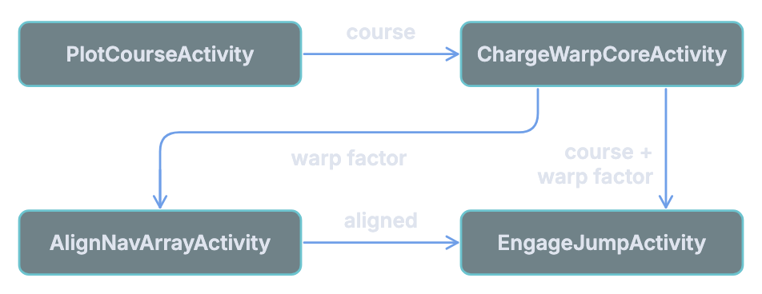

# Task chaining

In this lab, you'll run a workflow that chains four activities, with the result of each one passed on to the next. This hands-on lab takes about 6 minutes to complete.

## Before you start

The terminals, and the applications running in them, stay as they are when you move between labs. Open the **Dev Dashboard** tab and look at which applications are running. If any are, for example `engineering` from the previous lab, use the **Dapr CLI** window to stop them by pressing `Ctrl+C`. They use the same ports as the app in this lab. Then go back to the **Editor** tab.

## 1. The chain

Before the *ISV Meridian* can jump, the **engineering** console has to run four steps in a fixed order. The step after one needs what the previous one produced. In this lab the workflow `JumpWorkflow` runs four activities in sequence, and each activity's result is the next one's input. This is the **task chaining** pattern.

| Step | Activity | Gets | Returns |
|---|---|---|---|
| 1 | `PlotCourseActivity` | the destination | the course: destination, heading and distance |
| 2 | `ChargeWarpCoreActivity` | the course | the warp factor |
| 3 | `AlignNavArrayActivity` | the warp factor | whether the nav array is aligned |
| 4 | `EngageJumpActivity` | the course and the warp factor | where the ship arrived, and the stardate |



Each activity takes about a second, so you can watch the chain progress. The workflow's output is the result of the last step.

Use the **Editor** tab to open the demo folder of your language: `dotnet/Demo2-TaskChaining`, `python/demo2-task-chaining`, `java/demo2-task-chaining` or `typescript/demo2-task-chaining`. The `engineering` app has the same two endpoints as in the previous lab: `POST /jumps` starts a workflow, and `GET /jumps/{jumpId}` returns its status and result. This time you can also send a `destination` in the body of the request.

## 2. Run the demo

> [!IMPORTANT]
> When you use the *Run* button on a command, select the matching terminal from the dropdown that appears.

Use the **Dapr CLI** window to go to the `workflow` folder first:

```bash,run
cd /root/university-labs/workflow
```

> [!IMPORTANT]
> Run `dapr run -f .` from inside the demo folder of your language: `Demo2-TaskChaining` for .NET, `demo2-task-chaining` for Python, Java and TypeScript. The `resourcesPaths` in `dapr.yaml` are relative to that folder.

<details>
   <summary><b>.NET</b></summary>

Use the **Dapr CLI** window to run the commands.

Navigate to the *dotnet/Demo2-TaskChaining* folder:

```bash,run
cd dotnet/Demo2-TaskChaining
```

Run the application using the Dapr CLI:

```bash,run
dapr run -f .
```

</details>

<details>
   <summary><b>Python</b></summary>

Use the **Dapr CLI** window to run the commands.

Navigate to the *python/demo2-task-chaining* folder:

```bash,run
cd python/demo2-task-chaining
```

Run the application using the Dapr CLI:

```bash,run
dapr run -f .
```

</details>

<details>
   <summary><b>Java</b></summary>

Use the **Dapr CLI** window to run the commands.

Navigate to the *java/demo2-task-chaining* folder:

```bash,run
cd java/demo2-task-chaining
```

Run the application using the Dapr CLI:

```bash,run
dapr run -f .
```

</details>

<details>
   <summary><b>TypeScript</b></summary>

Use the **Dapr CLI** window to run the commands.

Navigate to the *typescript/demo2-task-chaining* folder:

```bash,run
cd typescript/demo2-task-chaining
```

Run the application using the Dapr CLI:

```bash,run
dapr run -f .
```

</details>

###

> [!IMPORTANT]
> Wait until the application is running before continuing. The Java application can take a little longer to start.
>
> Open the **Dev Dashboard** tab and check the application health on the **Applications** page: `engineering` is ready when the **Health** column shows a green dot. You can also inspect the output of the **Dapr CLI** window.

## 3. Start a jump

Use the **curl** window to start a jump with the ID `jump-001` to *Vesper Reach*:

```bash,run
curl -s -X POST http://localhost:5301/jumps -H 'Content-Type: application/json' -d '{"jumpId": "jump-001", "destination": "Vesper Reach"}' | jq
```

Expected output:

```json,nocopy
{
  "jumpId": "jump-001"
}
```

Open the **Dev Dashboard** tab, go to the **Workflows** page and select the `jump-001` instance of `JumpWorkflow`. Its **Event history** shows the chain, one step at a time:

- An `ExecutionStarted` event. Its input has the jump ID and the destination.
- For each activity, a `TaskScheduled` event with the activity's name, followed about a second later by a `TaskCompleted` event. The four activities appear in the order of the table above. Each one is scheduled only after the one before it has completed.
- An `ExecutionCompleted` event at the end, with the workflow's output.

Expand a `TaskCompleted` event to see what the activity returned, and the `TaskScheduled` event that follows it to see the input of the next activity. The course that `PlotCourseActivity` returned, with heading `217` and distance `4.2`, is the input of `ChargeWarpCoreActivity`. The warp factor `6` that `ChargeWarpCoreActivity` returned is the input of `AlignNavArrayActivity`.

After about four seconds, use the **curl** window to check the jump:

```bash,run
curl -s http://localhost:5301/jumps/jump-001 | jq
```

Expected output. If the status is still `RUNNING`, wait a moment and run the command again:

```json,nocopy
{
  "jumpId": "jump-001",
  "status": "COMPLETED",
  "output": {
    "arrivedAt": "Vesper Reach",
    "stardate": 85831.8
  }
}
```

The output is the result of the last activity. Your `stardate` will differ: `EngageJumpActivity` computes it from the clock. A whole number can show without the `.0`, depending on the language. The heading, the distance and the warp factor are fixed values, so every run and every language shows the same values in the event history.

## 4. Look at the workflow code

The chain is just a few lines in a row. Each `await` (or `yield` in Python and TypeScript) is a checkpoint, and the result it returns goes straight into the next call. Expand the language-specific instructions to see the four calls.

<details>
   <summary><b>.NET</b></summary>

`dotnet/Demo2-TaskChaining/Engineering/JumpWorkflow.cs`:

```csharp,nocopy
var course = await context.CallActivityAsync<Course>(nameof(PlotCourseActivity), jump.Destination);
var warpCore = await context.CallActivityAsync<WarpCore>(nameof(ChargeWarpCoreActivity), course);
await context.CallActivityAsync<NavArray>(nameof(AlignNavArrayActivity), warpCore.WarpFactor);
// The result of the last activity is the workflow's output.
return await context.CallActivityAsync<JumpResult>(nameof(EngageJumpActivity),
    new Engage(course, warpCore.WarpFactor));
```

</details>

<details>
   <summary><b>Python</b></summary>

`python/demo2-task-chaining/engineering/workflow.py`:

```python,nocopy
course = yield ctx.call_activity(plot_course_activity, input=jump["destination"])
warp_core = yield ctx.call_activity(charge_warp_core_activity, input=course)
yield ctx.call_activity(align_nav_array_activity, input=warp_core["warpFactor"])
# The result of the last activity is the workflow's output.
return (yield ctx.call_activity(
    engage_jump_activity, input={"course": course, "warpFactor": warp_core["warpFactor"]}
))
```

</details>

<details>
   <summary><b>Java</b></summary>

`java/demo2-task-chaining/engineering/src/main/java/io/diagrid/university/workflow/engineering/JumpWorkflow.java`:

```java,nocopy
Course course = ctx.callActivity("PlotCourseActivity", jump.destination(), Course.class).await();
WarpCore warpCore = ctx.callActivity("ChargeWarpCoreActivity", course, WarpCore.class).await();
ctx.callActivity("AlignNavArrayActivity", warpCore.warpFactor(), NavArray.class).await();
// The result of the last activity is the workflow's output.
ctx.complete(ctx.callActivity("EngageJumpActivity",
        new Engage(course, warpCore.warpFactor()), JumpResult.class).await());
```

</details>

<details>
   <summary><b>TypeScript</b></summary>

`typescript/demo2-task-chaining/engineering/workflow.ts`:

```typescript,nocopy
const course: Course = yield ctx.callActivity("PlotCourseActivity", jump.destination);
const warpCore: { warpFactor: number } = yield ctx.callActivity("ChargeWarpCoreActivity", course);
yield ctx.callActivity("AlignNavArrayActivity", warpCore.warpFactor);
const engage: Engage = { course, warpFactor: warpCore.warpFactor };
// The result of the last activity is the workflow's output.
const arrival: JumpResult = yield ctx.callActivity("EngageJumpActivity", engage);
return arrival;
```

</details>

Because every activity result is saved in the workflow's history, a crash between two steps doesn't redo the steps that finished. That is the lesson of the previous lab, now with different activities.

## 5. Try another destination

Use the **curl** window to send a jump to *Calder Station*:

```bash,run
curl -s -X POST http://localhost:5301/jumps -H 'Content-Type: application/json' -d '{"jumpId": "jump-002", "destination": "Calder Station"}' | jq
```

Expected output:

```json,nocopy
{
  "jumpId": "jump-002"
}
```

Select the `jump-002` instance on the **Workflows** page and look at its **Event history**. The destination travels down the chain: it's in the input of the `ExecutionStarted` event, in the course that `PlotCourseActivity` returned, and in the output of the last `TaskCompleted` event. Then check the result:

```bash,run
curl -s http://localhost:5301/jumps/jump-002 | jq
```

The `arrivedAt` value is now `Calder Station`.

## 6. Reuse a jump ID

The `jumpId` you send becomes the workflow's instance ID, and an ID can be used by only one running workflow at a time. Start `jump-003` and start it again right away, while it is still running. Both commands are in one block, so they run back to back:

```bash,run
curl -s -X POST http://localhost:5301/jumps -H 'Content-Type: application/json' -d '{"jumpId": "jump-003"}' | jq
curl -s -X POST http://localhost:5301/jumps -H 'Content-Type: application/json' -d '{"jumpId": "jump-003"}' | jq
```

Expected output: the first start is accepted, the second one fails.

```json,nocopy
{
  "jumpId": "jump-003"
}
{
  "error": "WORKFLOW_ERROR"
}
```

The Dapr sidecar refused the second start, so it never became part of the workflow's history. On the **Workflows** page, `jump-003` has a single `ExecutionStarted` event, from the first start. The reason for the refusal is only in the app's log. Go to the **Logs** page of the **Dev Dashboard** tab, select `engineering` and search for `workflow call failed`. The line ends with the reason: an active workflow with ID `jump-003` already exists.

If you see `jump-003` twice instead, the first jump had already finished when the second start arrived, so the second start was accepted. That is the case below: the jump simply started over. Run the block again right after it to see the error.

Once `jump-003` has completed, the same call works again: the jump starts over, the chain runs again and the old result is replaced. Use a new ID, or leave out `jumpId` and let the app generate one.

## 7. Clean up

The workflow history stays in Redis after the app stops, and every demo in this track uses the same app ID, `engineering`. Use the **curl** window to purge the history of the finished jumps while the app is still running:

```bash,run
dapr workflow purge --all -a engineering
```

> [!TIP]
> You can also purge workflows from the Dapr Dev Dashboard instead of the CLI. On the **Workflows** page of the **Dev Dashboard** tab, select the checkbox of each run you want to remove and click **Purge via Dapr API**. Like the CLI, the dashboard purges through the app's sidecar, so do this before you stop the app.

## 8. Stop the applications

Use the **Dapr CLI** window to stop the application by pressing `Ctrl+C`.

---

You chained four activities with a few lines of ordinary code, and every step passed its result to the next one.

## What's next?

In the next lab you'll run several activities at the same time and wait for all of them: the fan-out/fan-in pattern.
