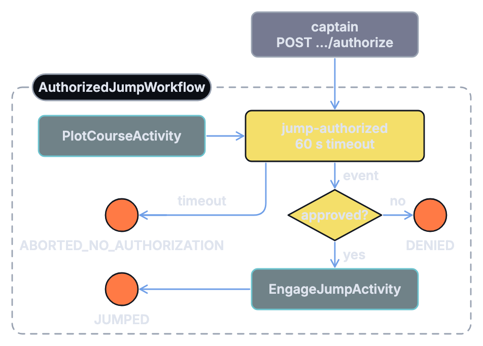

# Human in the loop

In this lab, you'll run a workflow that waits for the captain to authorize a jump. You'll approve one jump, deny another and let a third one time out. This hands-on lab takes about 8 minutes to complete.

## Before you start

The terminals, and the applications running in them, stay as they are when you move between labs. Open the **Dev Dashboard** tab and look at which applications are running. If any are, for example `engineering` from the previous lab, use the **Dapr CLI** window to stop them by pressing `Ctrl+C`. They use the same ports as the app in this lab. Then go back to the **Editor** tab.

## 1. Waiting for the captain

No jump goes ahead without the captain's word. In this lab the workflow `AuthorizedJumpWorkflow` plots the course and then waits for the captain. This is the **human in the loop** pattern: the workflow stops at a point where a person has to decide, and continues when the decision arrives.

The workflow has three steps:

1. It calls `PlotCourseActivity`, the same activity as in the task chaining lab.
2. It logs that the jump is awaiting the captain's authorization.
3. It waits for an **external event** named `jump-authorized`, for at most 60 seconds. The wait has a timeout built in, so the workflow doesn't need a timer of its own.

There are three outcomes:

| Outcome | What the workflow does | Output `status` |
|---|---|---|
| Approved | Engages the jump to Vesper Reach. | `JUMPED` |
| Denied | Doesn't engage. | `DENIED` |
| No answer within 60 seconds | Gives up on the jump. | `ABORTED_NO_AUTHORIZATION` |

The `engineering` app has the same two endpoints as before, and one more that raises the event:

| Method and route | What it does |
|---|---|
| `POST /jumps/{jumpId}/authorize` | Raises the `jump-authorized` event. Body: `{"approved": true, "officer": "Captain Ilsa Varn"}`. Answers `202`. An unknown jump answers `404` with `JUMP_NOT_FOUND`. A jump that has finished answers `409` with `JUMP_FINISHED`, and the event isn't raised. |



Use the **Editor** tab to open the demo folder of your language: `dotnet/Demo5-HumanInTheLoop`, `python/demo5-human-in-the-loop`, `java/demo5-human-in-the-loop` or `typescript/demo5-human-in-the-loop`.

## 2. Run the demo

> [!IMPORTANT]
> When you use the *Run* button on a command, select the matching terminal from the dropdown that appears.

Use the **Dapr CLI** window to go to the `workflow` folder first:

```bash,run
cd /root/university-labs/workflow
```

> [!IMPORTANT]
> Run `dapr run -f .` from inside the demo folder of your language: `Demo5-HumanInTheLoop` for .NET, `demo5-human-in-the-loop` for Python, Java and TypeScript. The `resourcesPaths` in `dapr.yaml` are relative to that folder.

<details>
   <summary><b>.NET</b></summary>

Use the **Dapr CLI** window to run the commands.

Navigate to the *dotnet/Demo5-HumanInTheLoop* folder:

```bash,run
cd dotnet/Demo5-HumanInTheLoop
```

Run the application using the Dapr CLI:

```bash,run
dapr run -f .
```

</details>

<details>
   <summary><b>Python</b></summary>

Use the **Dapr CLI** window to run the commands.

Navigate to the *python/demo5-human-in-the-loop* folder:

```bash,run
cd python/demo5-human-in-the-loop
```

Run the application using the Dapr CLI:

```bash,run
dapr run -f .
```

</details>

<details>
   <summary><b>Java</b></summary>

Use the **Dapr CLI** window to run the commands.

Navigate to the *java/demo5-human-in-the-loop* folder:

```bash,run
cd java/demo5-human-in-the-loop
```

Run the application using the Dapr CLI:

```bash,run
dapr run -f .
```

</details>

<details>
   <summary><b>TypeScript</b></summary>

Use the **Dapr CLI** window to run the commands.

Navigate to the *typescript/demo5-human-in-the-loop* folder:

```bash,run
cd typescript/demo5-human-in-the-loop
```

Run the application using the Dapr CLI:

```bash,run
dapr run -f .
```

</details>

###

> [!IMPORTANT]
> Wait until the application is running before continuing. The Java application can take a little longer to start.
>
> Open the **Dev Dashboard** tab and check the application health on the **Applications** page: `engineering` is ready when the **Health** column shows a green dot. You can also inspect the output of the **Dapr CLI** window.

## 3. Approve a jump

Use the **curl** window to start `jump-001`, wait 3 seconds and check the status. The three commands are in one block, so they run back to back:

```bash,run
curl -s -X POST http://localhost:5301/jumps -H 'Content-Type: application/json' -d '{"jumpId": "jump-001"}' | jq
sleep 3
curl -s http://localhost:5301/jumps/jump-001 | jq
```

Expected output:

```json,nocopy
{
  "jumpId": "jump-001"
}
{
  "jumpId": "jump-001",
  "status": "RUNNING",
  "output": null
}
```

Open the **Dev Dashboard** tab, go to the **Workflows** page and select the `jump-001` instance of `AuthorizedJumpWorkflow`. Its **Event history** shows how far the jump got:

- An `ExecutionStarted` event.
- A `TaskScheduled` and a `TaskCompleted` event for `PlotCourseActivity`: the course is plotted.
- A `TimerCreated` event for the 60-second timeout of the wait.

Nothing comes after that: the workflow waits for the captain. The jump is `RUNNING`, but nothing runs in the app while it waits: no thread and no timer in memory. Dapr stores the wait, and the workflow only continues when the event arrives or the 60 seconds have passed.

Use the **curl** window to approve the jump as the captain, wait 3 seconds and check the status:

```bash,run
curl -s -w ' %{http_code}\n' -X POST http://localhost:5301/jumps/jump-001/authorize -H 'Content-Type: application/json' -d '{"approved": true, "officer": "Captain Ilsa Varn"}' | jq
sleep 3
curl -s http://localhost:5301/jumps/jump-001 | jq
```

Expected output, with the HTTP status code of the authorize call on the first line:

```json,nocopy
202
{
  "jumpId": "jump-001",
  "status": "COMPLETED",
  "output": {
    "status": "JUMPED",
    "authorizedBy": "Captain Ilsa Varn"
  }
}
```

If the status is still `RUNNING`, wait a moment and run the status command again:

```bash,run
curl -s http://localhost:5301/jumps/jump-001 | jq
```

Look at the **Event history** of `jump-001` again. After the `TimerCreated` event there is now an `EventRaised` event named `jump-authorized`. Expand it to see the captain's answer: the body you sent to the authorize endpoint. The event carried that answer into the workflow, which engaged the jump: a `TaskScheduled` and a `TaskCompleted` event for `EngageJumpActivity` follow, and then an `ExecutionCompleted` event with the output.

## 4. Deny a jump

Use the **curl** window to start `jump-002` and deny it this time, with `"approved": false`:

```bash,run
curl -s -X POST http://localhost:5301/jumps -H 'Content-Type: application/json' -d '{"jumpId": "jump-002"}' | jq
sleep 3
curl -s -w ' %{http_code}\n' -X POST http://localhost:5301/jumps/jump-002/authorize -H 'Content-Type: application/json' -d '{"approved": false, "officer": "Captain Ilsa Varn"}' | jq
sleep 2
curl -s http://localhost:5301/jumps/jump-002 | jq
```

Expected output:

```json,nocopy
{
  "jumpId": "jump-002"
}
202
{
  "jumpId": "jump-002",
  "status": "COMPLETED",
  "output": {
    "status": "DENIED",
    "authorizedBy": "Captain Ilsa Varn"
  }
}
```

The workflow doesn't engage. Select the `jump-002` instance on the **Workflows** page: its `EventRaised` event has `"approved": false`, and the `ExecutionCompleted` event follows straight after it. There is no `EngageJumpActivity` in this history.

> [!NOTE]
> Send the request bodies exactly as shown on this page. The endpoint doesn't check the body, and what happens with a missing or malformed body differs per language.

## 5. Let a jump time out

Use the **curl** window to start `jump-003`. This time, send nothing:

```bash,run
curl -s -X POST http://localhost:5301/jumps -H 'Content-Type: application/json' -d '{"jumpId": "jump-003"}' | jq
```

Expected output:

```json,nocopy
{
  "jumpId": "jump-003"
}
```

On the **Workflows** page, the history of `jump-003` stops at the `TimerCreated` event, like `jump-001` did before you approved it. The wait ends after 60 seconds. Read the workflow code in the next step while you wait.

## 6. Look at the workflow code

The part to look at is the wait for the external event, with its timeout, and the branch on the three outcomes. Expand the language-specific instructions to see it.

<details>
   <summary><b>.NET</b></summary>

`dotnet/Demo5-HumanInTheLoop/Engineering/AuthorizedJumpWorkflow.cs`:

```csharp,nocopy
// Wait for the external event "jump-authorized", raised by POST /jumps/{jumpId}/authorize.
// With a timeout, the wait throws a TaskCanceledException when nobody answers in time.
Authorization authorization;
try
{
    authorization = await context.WaitForExternalEventAsync<Authorization>("jump-authorized", TimeSpan.FromSeconds(60));
}
catch (TaskCanceledException)
{
    logger.LogInformation("engineering {JumpId} jump aborted, no authorization", jump.JumpId);
    return new JumpOutcome("ABORTED_NO_AUTHORIZATION", null);
}

if (!authorization.Approved)
{
    logger.LogInformation("engineering {JumpId} jump denied by {Officer}", jump.JumpId, authorization.Officer);
    return new JumpOutcome("DENIED", authorization.Officer);
}

// Engage with a fixed warp factor: this demo has no warp core charging step.
await context.CallActivityAsync<JumpResult>(nameof(EngageJumpActivity), new Engage(course, 6));
return new JumpOutcome("JUMPED", authorization.Officer);
```

</details>

<details>
   <summary><b>Python</b></summary>

`python/demo5-human-in-the-loop/engineering/workflow.py`:

```python,nocopy
# Wait for the external event "jump-authorized", raised by POST /jumps/{jumpId}/authorize.
# With a timeout, the wait raises a TimeoutError when nobody answers in time.
try:
    authorization = yield ctx.wait_for_external_event("jump-authorized", timeout=timedelta(seconds=60))
except TimeoutError:
    if not ctx.is_replaying:
        logger.info("engineering %s jump aborted, no authorization", jump_id)
    return {"status": "ABORTED_NO_AUTHORIZATION"}

officer = authorization["officer"]
if not authorization["approved"]:
    if not ctx.is_replaying:
        logger.info("engineering %s jump denied by %s", jump_id, officer)
    return {"status": "DENIED", "authorizedBy": officer}

# Engage with a fixed warp factor: this demo has no warp core charging step.
yield ctx.call_activity(engage_jump_activity, input={"course": course, "warpFactor": 6})
return {"status": "JUMPED", "authorizedBy": officer}
```

</details>

<details>
   <summary><b>Java</b></summary>

`java/demo5-human-in-the-loop/engineering/src/main/java/io/diagrid/university/workflow/engineering/AuthorizedJumpWorkflow.java`:

```java,nocopy
// Wait for the external event "jump-authorized", raised by POST /jumps/{jumpId}/authorize.
// With a timeout, the wait throws a TaskCanceledException when nobody answers in time.
Authorization authorization;
try {
    authorization = ctx.waitForExternalEvent("jump-authorized", Duration.ofSeconds(60), Authorization.class)
            .await();
} catch (TaskCanceledException e) {
    ctx.getLogger().info("engineering {} jump aborted, no authorization", jump.jumpId());
    ctx.complete(new JumpOutcome("ABORTED_NO_AUTHORIZATION", null));
    return;
}

if (!authorization.approved()) {
    ctx.getLogger().info("engineering {} jump denied by {}", jump.jumpId(), authorization.officer());
    ctx.complete(new JumpOutcome("DENIED", authorization.officer()));
    return;
}

// Engage with a fixed warp factor: this demo has no warp core charging step.
ctx.callActivity("EngageJumpActivity", new Engage(course, 6), JumpResult.class).await();
ctx.complete(new JumpOutcome("JUMPED", authorization.officer()));
```

</details>

<details>
   <summary><b>TypeScript</b></summary>

`typescript/demo5-human-in-the-loop/engineering/workflow.ts`:

```typescript,nocopy
// Wait for the external event "jump-authorized", raised by POST /jumps/{jumpId}/authorize.
// With a timeout, the wait rejects when nobody answers in time.
let authorization: Authorization;
try {
  authorization = yield ctx.waitForExternalEvent("jump-authorized", { timeoutInSeconds: 60 });
} catch (err) {
  // Only a timeout means nobody answered; anything else is a real error.
  if (!(err instanceof TaskTimeoutError)) {
    throw err;
  }
  if (!ctx.isReplaying()) {
    console.log(`engineering ${jump.jumpId} jump aborted, no authorization`);
  }
  return { status: "ABORTED_NO_AUTHORIZATION" };
}

if (!authorization.approved) {
  if (!ctx.isReplaying()) {
    console.log(`engineering ${jump.jumpId} jump denied by ${authorization.officer}`);
  }
  return { status: "DENIED", authorizedBy: authorization.officer };
}

// Engage with a fixed warp factor: this demo has no warp core charging step.
const engage: Engage = { course, warpFactor: 6 };
yield ctx.callActivity("EngageJumpActivity", engage);
return { status: "JUMPED", authorizedBy: authorization.officer };
```

</details>

The event name `jump-authorized` links the endpoint and the workflow: the endpoint raises an event with that name for the jump's ID, and the workflow waits for it. The event's body becomes the `authorization` value. When the timeout passes first, the wait fails with the SDK's timeout error, and the workflow handles that as the third outcome.

The wait and its timeout are stored by Dapr, not by the app. If you stopped the app while a jump waits and started it again, the jump would still be waiting, and the 60 seconds would keep counting.

## 7. Check the timed-out jump

Select the `jump-003` instance on the **Workflows** page. When the 60 seconds have passed, its **Event history** shows a `TimerFired` event, where the other two jumps had an `EventRaised` event, followed by an `ExecutionCompleted` event. Then use the **curl** window to check the status. If it's still `RUNNING`, the 60 seconds haven't passed yet. Wait a few seconds and run the command again:

```bash,run
curl -s http://localhost:5301/jumps/jump-003 | jq
```

Expected output:

```json,nocopy
{
  "jumpId": "jump-003",
  "status": "COMPLETED",
  "output": {
    "status": "ABORTED_NO_AUTHORIZATION"
  }
}
```

Nobody answered in time, so the output has no `authorizedBy`.

Now try to authorize `jump-003` anyway. Use the **curl** window:

```bash,run
curl -s -w ' %{http_code}\n' -X POST http://localhost:5301/jumps/jump-003/authorize -H 'Content-Type: application/json' -d '{"approved": true, "officer": "Captain Ilsa Varn"}' | jq
```

Expected output:

```json,nocopy
{
  "error": "JUMP_FINISHED"
}
409
```

The jump has finished, so the app answers `409` and doesn't raise the event. The output of `jump-003` stays as it was, and its history has no `EventRaised` event.

## 8. Clean up

The workflow history stays in Redis after the app stops, and every demo in this track uses the same app ID, `engineering`. A jump that is still waiting when you stop the app is picked up again by the next `engineering` app you start. Use the **curl** window, while the app is still running, to list the jumps that are still `RUNNING`:

```bash,run
dapr workflow list -a engineering -s RUNNING
```

If you followed the steps, every jump has finished:

```text,nocopy
❌  No workflow found in namespace "default" for app ID "engineering"
```

If the list shows a jump, terminate it by its ID, for example `jump-003`:

```bash,run
dapr workflow terminate jump-003 -a engineering
```

Then purge the history of the finished jumps:

```bash,run
dapr workflow purge --all -a engineering
```

> [!TIP]
> You can also purge workflows from the Dapr Dev Dashboard instead of the CLI. On the **Workflows** page of the **Dev Dashboard** tab, select the checkbox of each run you want to remove and click **Purge via Dapr API**. A run that is still running or suspended is terminated first and then purged, so you don't need a separate terminate. Like the CLI, the dashboard does this through the app's sidecar, so do it before you stop the app.

## 9. Stop the applications

Use the **Dapr CLI** window to stop the application by pressing `Ctrl+C`.

---

You made a workflow wait for a person: it waited for the captain's decision, continued on approval or denial, and gave up when no answer came in time.

## What's next?

In the next lab you'll manage a running workflow from the outside: pause, resume, terminate and purge a long jump.
