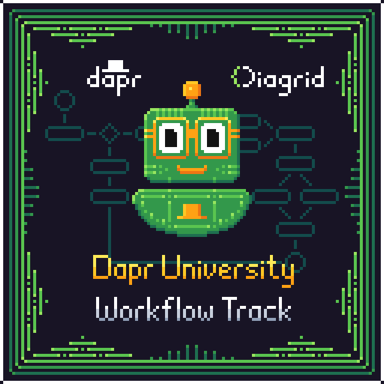

# Workflow management

In this final lab, you'll manage a long jump from the outside: pause it, resume it, terminate it and purge its history, first through the app's endpoints and then with the Dapr CLI. This hands-on lab takes about 8 minutes to complete. At the end of the lab, you can claim the Dapr University Holopin badge for this track.

## Before you start

The terminals, and the applications running in them, stay as they are when you move between labs. Open the **Dev Dashboard** tab and look at which applications are running. If any are, for example `engineering` from the previous lab, use the **Dapr CLI** window to stop them by pressing `Ctrl+C`. They use the same ports as the app in this lab. Then go back to the **Editor** tab.

## 1. A jump long enough to manage

So far you started a workflow and then waited for it. A real system also needs to act on a workflow while it runs: hold it, let it continue, stop it for good, or remove what's left of it.

In this lab the workflow `LongRangeJumpWorkflow` is a jump long enough to manage by hand. It has 10 legs. Each leg is one call to `EngageLegActivity`, which logs a line such as `engineering jump-001 leg 4/10 complete`, followed by a durable timer of 5 seconds. A whole jump takes about a minute and ends with `{"status": "JUMPED", "arrivedAt": "Vesper Reach"}`.

The `engineering` app has the same two endpoints as before, and four more. Each one is a single call on the SDK's workflow client:

| Method and route | What it does |
|---|---|
| `POST /jumps/{jumpId}/pause` | Suspends the workflow. Answers `202`. |
| `POST /jumps/{jumpId}/resume` | Resumes a suspended workflow. Answers `202`. |
| `POST /jumps/{jumpId}/terminate` | Terminates the workflow. Answers `202`. |
| `DELETE /jumps/{jumpId}` | Purges the workflow's history from the state store. Answers `204`. |

An unknown jump answers `404` with `JUMP_NOT_FOUND` on all four. Pause, resume and terminate on a jump that has finished answer `409` with `JUMP_FINISHED`.

Use the **Editor** tab to open the demo folder of your language: `dotnet/Demo6-Management`, `python/demo6-management`, `java/demo6-management` or `typescript/demo6-management`.

## 2. Run the demo

> [!IMPORTANT]
> When you use the *Run* button on a command, select the matching terminal from the dropdown that appears.

Use the **Dapr CLI** window to go to the `workflow` folder first:

```bash,run
cd /root/university-labs/workflow
```

> [!IMPORTANT]
> Run `dapr run -f .` from inside the demo folder of your language: `Demo6-Management` for .NET, `demo6-management` for Python, Java and TypeScript. The `resourcesPaths` in `dapr.yaml` are relative to that folder.

<details>
   <summary><b>.NET</b></summary>

Use the **Dapr CLI** window to run the commands.

Navigate to the *dotnet/Demo6-Management* folder:

```bash,run
cd dotnet/Demo6-Management
```

Run the application using the Dapr CLI:

```bash,run
dapr run -f .
```

</details>

<details>
   <summary><b>Python</b></summary>

Use the **Dapr CLI** window to run the commands.

Navigate to the *python/demo6-management* folder:

```bash,run
cd python/demo6-management
```

Run the application using the Dapr CLI:

```bash,run
dapr run -f .
```

</details>

<details>
   <summary><b>Java</b></summary>

Use the **Dapr CLI** window to run the commands.

Navigate to the *java/demo6-management* folder:

```bash,run
cd java/demo6-management
```

Run the application using the Dapr CLI:

```bash,run
dapr run -f .
```

</details>

<details>
   <summary><b>TypeScript</b></summary>

Use the **Dapr CLI** window to run the commands.

Navigate to the *typescript/demo6-management* folder:

```bash,run
cd typescript/demo6-management
```

Run the application using the Dapr CLI:

```bash,run
dapr run -f .
```

</details>

###

> [!IMPORTANT]
> Wait until the application is running before continuing. The Java application can take a little longer to start.
>
> Open the **Dev Dashboard** tab and check the application health on the **Applications** page: `engineering` is ready when the **Health** column shows a green dot. You can also inspect the output of the **Dapr CLI** window.

## 3. Pause a jump

Use the **curl** window to start `jump-001`, wait 8 seconds, pause it, wait 2 seconds and check the status. The commands are in one block, so they run back to back:

```bash,run
curl -s -X POST http://localhost:5301/jumps -H 'Content-Type: application/json' -d '{"jumpId": "jump-001"}' | jq
sleep 8
curl -s -w ' %{http_code}\n' -X POST http://localhost:5301/jumps/jump-001/pause | jq
sleep 2
curl -s http://localhost:5301/jumps/jump-001 | jq
```

Expected output, with the HTTP status code of the pause call on its own line:

```json,nocopy
{
  "jumpId": "jump-001"
}
202
{
  "jumpId": "jump-001",
  "status": "SUSPENDED",
  "output": null
}
```

The pause takes effect a moment after the `202`. If the status is still `RUNNING`, run the status command again:

```bash,run
curl -s http://localhost:5301/jumps/jump-001 | jq
```

Open the **Dev Dashboard** tab, go to the **Workflows** page and select the `jump-001` instance of `LongRangeJumpWorkflow`. In its **Event history**, each leg is a `TaskScheduled` and a `TaskCompleted` event for `EngageLegActivity`, followed by a `TimerCreated` and a `TimerFired` event for the 5-second wait. Expand a `TaskScheduled` event to see the leg number in its input. Before the pause, the jump completed one or two legs.

The pause added an `ExecutionSuspended` event. Look at the history again after a while: no new `TaskScheduled` event appears. The timer of the current leg still fires, because Dapr stores it, but the workflow only continues after it is resumed.

## 4. Try to purge a paused jump

Purge removes a workflow's history from the state store. Dapr only allows that for a workflow that has finished. A paused jump hasn't finished, so use the **curl** window to try to purge `jump-001` now:

```bash,run
curl -s -w ' %{http_code}\n' -X DELETE http://localhost:5301/jumps/jump-001 | jq
```

Expected output:

```json,nocopy
{
  "error": "WORKFLOW_ERROR"
}
500
```

Dapr refused the purge. A refused call doesn't change the workflow, so it isn't in the event history. The reason is in the app's log: go to the **Logs** page of the **Dev Dashboard** tab, select `engineering` and search for `workflow call failed`. The warning contains `orchestration has not yet completed`. Use the **curl** window to check that the jump is still paused:

```bash,run
curl -s http://localhost:5301/jumps/jump-001 | jq
```

Expected output:

```json,nocopy
{
  "jumpId": "jump-001",
  "status": "SUSPENDED",
  "output": null
}
```

## 5. Resume the jump

Use the **curl** window to resume `jump-001`, wait 2 seconds and check the status:

```bash,run
curl -s -w ' %{http_code}\n' -X POST http://localhost:5301/jumps/jump-001/resume | jq
sleep 2
curl -s http://localhost:5301/jumps/jump-001 | jq
```

Expected output:

```json,nocopy
202
{
  "jumpId": "jump-001",
  "status": "RUNNING",
  "output": null
}
```

If the status is still `SUSPENDED`, run the status command again:

```bash,run
curl -s http://localhost:5301/jumps/jump-001 | jq
```

Look at the **Event history** of `jump-001` on the **Workflows** page. An `ExecutionResumed` event follows the `ExecutionSuspended` event, and after it new `TaskScheduled` events for `EngageLegActivity` appear. Expand the first one: it's the next leg, for example leg 3. The jump doesn't start over from leg 1: the workflow picks up from its stored history. It finishes in about 40 seconds, and you'll check its result in step 7.

## 6. Terminate a jump

Use the **curl** window to start a second jump, `jump-002`, wait 7 seconds, terminate it, wait 2 seconds and check the status:

```bash,run
curl -s -X POST http://localhost:5301/jumps -H 'Content-Type: application/json' -d '{"jumpId": "jump-002"}' | jq
sleep 7
curl -s -w ' %{http_code}\n' -X POST http://localhost:5301/jumps/jump-002/terminate | jq
sleep 2
curl -s http://localhost:5301/jumps/jump-002 | jq
```

Expected output:

```json,nocopy
{
  "jumpId": "jump-002"
}
202
{
  "jumpId": "jump-002",
  "status": "TERMINATED",
  "output": null
}
```

If the status is still `RUNNING`, run the status command again:

```bash,run
curl -s http://localhost:5301/jumps/jump-002 | jq
```

Select the `jump-002` instance on the **Workflows** page. Its **Event history** has an `ExecutionTerminated` event, and no new legs follow it. A terminated jump has finished for good, and it has no output. Unlike a paused jump, it can't be resumed.

Use the **curl** window to try to pause `jump-002`:

```bash,run
curl -s -w ' %{http_code}\n' -X POST http://localhost:5301/jumps/jump-002/pause | jq
```

Expected output:

```json,nocopy
{
  "error": "JUMP_FINISHED"
}
409
```

The app checks the status first and answers `409` without calling Dapr. Now try a jump that doesn't exist:

```bash,run
curl -s -w ' %{http_code}\n' -X POST http://localhost:5301/jumps/jump-999/pause | jq
```

Expected output:

```json,nocopy
{
  "error": "JUMP_NOT_FOUND"
}
404
```

## 7. Purge a finished jump

`jump-002` has finished, so its history can be purged. Use the **curl** window to purge it and then ask for it:

```bash,run
curl -s -w ' %{http_code}\n' -X DELETE http://localhost:5301/jumps/jump-002 | jq
curl -s -w ' %{http_code}\n' http://localhost:5301/jumps/jump-002 | jq
```

Expected output:

```json,nocopy
204
{
  "error": "JUMP_NOT_FOUND"
}
404
```

The purge answered `204`, and the history is gone: Dapr no longer knows `jump-002`.

Now check `jump-001`, the jump you paused and resumed. Use the **curl** window. If it's still `RUNNING`, wait a few seconds and run the command again:

```bash,run
curl -s http://localhost:5301/jumps/jump-001 | jq
```

Expected output:

```json,nocopy
{
  "jumpId": "jump-001",
  "status": "COMPLETED",
  "output": {
    "status": "JUMPED",
    "arrivedAt": "Vesper Reach"
  }
}
```

The pause made the jump take longer, but it lost nothing: every leg ran once, and the jump arrived. The **Event history** of `jump-001` shows a `TaskScheduled` event for each of the 10 legs, with the `ExecutionSuspended` and `ExecutionResumed` events in between, and ends with an `ExecutionCompleted` event.

## 8. Look at the endpoint code

The part to look at is the call on the workflow client behind each endpoint. Expand the language-specific instructions to see it.

<details>
   <summary><b>.NET</b></summary>

`dotnet/Demo6-Management/Engineering/Program.cs`:

```csharp,nocopy
// Each management endpoint is one call on the workflow client.
app.MapPost("/jumps/{jumpId}/pause", (string jumpId, DaprWorkflowClient workflowClient) =>
    Control(jumpId, workflowClient, () => workflowClient.SuspendWorkflowAsync(jumpId)));

app.MapPost("/jumps/{jumpId}/resume", (string jumpId, DaprWorkflowClient workflowClient) =>
    Control(jumpId, workflowClient, () => workflowClient.ResumeWorkflowAsync(jumpId)));

app.MapPost("/jumps/{jumpId}/terminate", (string jumpId, DaprWorkflowClient workflowClient) =>
    Control(jumpId, workflowClient, () => workflowClient.TerminateWorkflowAsync(jumpId)));

// Purge removes the history of a finished jump. A running jump can't be purged: the call fails
// and the error handler answers 500.
app.MapDelete("/jumps/{jumpId}", async Task<IResult> (string jumpId, DaprWorkflowClient workflowClient) =>
{
    var state = await workflowClient.GetWorkflowStateAsync(jumpId);
    if (!state.Exists)
    {
        return TypedResults.NotFound(new { error = "JUMP_NOT_FOUND" });
    }
    await workflowClient.PurgeInstanceAsync(jumpId);
    return TypedResults.NoContent();
});
```

`Control` reads the workflow state first and answers `404` or `409` when the jump is unknown or finished. Otherwise it makes the call and answers `202`.

</details>

<details>
   <summary><b>Python</b></summary>

`python/demo6-management/engineering/app.py`:

```python,nocopy
# Each management endpoint is one call on the workflow client.
@app.post("/jumps/{jump_id}/pause")
async def pause_jump(jump_id: str, client: WorkflowClientDep):
    await ensure_active(client, jump_id)
    await client.pause_workflow(jump_id)
    return Response(status_code=202)


@app.post("/jumps/{jump_id}/resume")
async def resume_jump(jump_id: str, client: WorkflowClientDep):
    await ensure_active(client, jump_id)
    await client.resume_workflow(jump_id)
    return Response(status_code=202)


@app.post("/jumps/{jump_id}/terminate")
async def terminate_jump(jump_id: str, client: WorkflowClientDep):
    await ensure_active(client, jump_id)
    await client.terminate_workflow(jump_id)
    return Response(status_code=202)


# Purge removes the history of a finished jump. A running jump can't be purged: the call fails
# and the error handler answers 500.
@app.delete("/jumps/{jump_id}")
async def purge_jump(jump_id: str, client: WorkflowClientDep):
    if await client.get_workflow_state(jump_id) is None:
        raise JumpError("JUMP_NOT_FOUND", 404)
    await client.purge_workflow(jump_id)
    return Response(status_code=204)
```

`ensure_active` reads the workflow state first and raises a `JumpError` with `404` or `409` when the jump is unknown or finished.

</details>

<details>
   <summary><b>Java</b></summary>

`java/demo6-management/engineering/src/main/java/io/diagrid/university/workflow/engineering/JumpController.java`:

```java,nocopy
// Each management endpoint is one call on the workflow client.
@PostMapping("/{jumpId}/pause")
@ResponseStatus(HttpStatus.ACCEPTED)
void pause(@PathVariable String jumpId) {
    requireUnfinished(jumpId);
    workflowClient.suspendWorkflow(jumpId, null);
}

@PostMapping("/{jumpId}/resume")
@ResponseStatus(HttpStatus.ACCEPTED)
void resume(@PathVariable String jumpId) {
    requireUnfinished(jumpId);
    workflowClient.resumeWorkflow(jumpId, null);
}

@PostMapping("/{jumpId}/terminate")
@ResponseStatus(HttpStatus.ACCEPTED)
void terminate(@PathVariable String jumpId) {
    requireUnfinished(jumpId);
    workflowClient.terminateWorkflow(jumpId, null);
}

// Purge removes the history of a finished jump. A running jump can't be purged: the call
// fails and the error handler answers 500.
@DeleteMapping("/{jumpId}")
@ResponseStatus(HttpStatus.NO_CONTENT)
void purge(@PathVariable String jumpId) {
    if (workflowClient.getWorkflowState(jumpId, false).getWorkflowId().isEmpty()) {
        throw new ApiErrors.JumpNotFoundException();
    }
    workflowClient.purgeWorkflow(jumpId);
}
```

`requireUnfinished` reads the workflow state first and throws an exception that answers `404` or `409` when the jump is unknown or finished.

</details>

<details>
   <summary><b>TypeScript</b></summary>

`typescript/demo6-management/engineering/app.ts`:

```typescript,nocopy
// Each management endpoint is one call on the workflow client.
app.post("/jumps/:jumpId/pause", async (req: Request<{ jumpId: string }>, res: Response) => {
  const { jumpId } = req.params;
  if (await rejectFinished(jumpId, res)) {
    return;
  }
  await workflowClient.suspendWorkflow(jumpId);
  res.status(202).end();
});

app.post("/jumps/:jumpId/resume", async (req: Request<{ jumpId: string }>, res: Response) => {
  // ...
  await workflowClient.resumeWorkflow(jumpId);
  res.status(202).end();
});

app.post("/jumps/:jumpId/terminate", async (req: Request<{ jumpId: string }>, res: Response) => {
  // ...
  await workflowClient.terminateWorkflow(jumpId);
  res.status(202).end();
});

// Purge removes the history of a finished jump. A running jump can't be purged: the call throws
// and the error handler answers 500.
app.delete("/jumps/:jumpId", async (req: Request<{ jumpId: string }>, res: Response) => {
  // ...
  await workflowClient.purgeWorkflow(jumpId);
  res.status(204).end();
});
```

`rejectFinished` reads the workflow state first and answers `404` or `409` when the jump is unknown or finished.

</details>

The app doesn't pause or stop anything itself. Each call asks the Dapr sidecar to change the workflow's state, and the workflow runtime in the app follows: a suspended workflow gets no new work until it is resumed, and a terminated one gets none at all.

## 9. The same with the Dapr CLI

The endpoints only wrap what Dapr already offers. The Dapr CLI's `dapr workflow` commands talk to the same sidecar and act on the same workflows, without any endpoint in your app.

Use the **curl** window to start `jump-003`:

```bash,run
curl -s -X POST http://localhost:5301/jumps -H 'Content-Type: application/json' -d '{"jumpId": "jump-003"}' | jq
```

Expected output:

```json,nocopy
{
  "jumpId": "jump-003"
}
```

Use the **curl** window to list the workflows of the `engineering` app:

```bash,run
dapr workflow list -a engineering
```

Expected output, with your own values in the `AGE` column:

```text,nocopy
NAME                   ID        STATUS     AGE
LongRangeJumpWorkflow  jump-001  COMPLETED  2m
LongRangeJumpWorkflow  jump-003  RUNNING    5s
```

With TypeScript, the list also has a `CUSTOM STATUS` column with `""` in it, because the TypeScript SDK sets an empty custom status.

`jump-002` isn't listed, because you purged it. Open the **Dev Dashboard** tab and go to the **Workflows** page: it lists the same `LongRangeJumpWorkflow` runs and their status.

Use the **curl** window to suspend `jump-003` with the CLI:

```bash,run
dapr workflow suspend jump-003 -a engineering
```

Expected output:

```text,nocopy
ℹ️  Workflow 'jump-003' suspended successfully
```

Use the **curl** window to check the status through the app:

```bash,run
curl -s http://localhost:5301/jumps/jump-003 | jq
```

Expected output:

```json,nocopy
{
  "jumpId": "jump-003",
  "status": "SUSPENDED",
  "output": null
}
```

Use the **curl** window to resume `jump-003` and then terminate it:

```bash,run
dapr workflow resume jump-003 -a engineering
```

```bash,run
dapr workflow terminate jump-003 -a engineering
```

Each command confirms what it did, for example:

```text,nocopy
ℹ️  Workflow 'jump-003' terminated successfully
```

`jump-003` is now `TERMINATED`, so it has finished. Use the **curl** window to purge it:

```bash,run
dapr workflow purge jump-003 -a engineering
```

Expected output:

```text,nocopy
ℹ️  Purging 1 workflow instance(s)
✅  Purged workflow instance "jump-003"
```

Like the endpoint, the CLI only purges a workflow that has finished.

## 10. Clean up

The workflow history stays in Redis after the app stops, and every demo in this track uses the same app ID, `engineering`. A jump that is still running or suspended when you stop the app is picked up again by the next `engineering` app you start. Use the **curl** window, while the app is still running, to list the jumps:

```bash,run
dapr workflow list -a engineering
```

If you followed the steps, only `jump-001` is left, and it has finished:

```text,nocopy
NAME                   ID        STATUS     AGE
LongRangeJumpWorkflow  jump-001  COMPLETED  3m
```

If the list shows a jump that is `RUNNING` or `SUSPENDED`, terminate it by its ID, for example `jump-001`:

```bash,run
dapr workflow terminate jump-001 -a engineering
```

Then purge the history of the finished jumps:

```bash,run
dapr workflow purge --all -a engineering
```

## 11. Stop the applications

Use the **Dapr CLI** window to stop the application by pressing `Ctrl+C`.

---

You managed workflows from the outside: you paused and resumed a jump without losing a leg, terminated another, and purged the history of finished jumps, through the app's workflow client and with the Dapr CLI.

Here is what you did in this track:

1. **Durable execution:** you stopped the app in the middle of a workflow, started it again, and watched the workflow carry on from the last completed step.
2. **Task chaining:** a workflow ran four activities in order, each one's output the next one's input.
3. **Fan-out/fan-in:** a workflow started five sensor scans at the same time, waited for all of them and combined the results.
4. **Monitor:** a workflow checked the warp core until it was stable, with a durable timer between checks and continue-as-new to keep its history small.
5. **Human in the loop:** a workflow waited for the captain's authorization, an external event with a timeout, and handled approval, denial and no answer.
6. **Workflow management:** you paused, resumed, terminated and purged jumps through the workflow client and with the Dapr CLI.

## Collect your badge & provide feedback

Congratulations! 🎉 You've completed the Dapr University Dapr Workflow 101 learning track!

### Next steps

We have more opportunities for you to learn and share knowledge:

**Try another university track**
- [Build Dapr workflows in .NET with Aspire](https://www.diagrid.io/university/dapr-workflow-aspire)
- [Dapr Agents: build LLM-powered applications with tools and workflows](https://www.diagrid.io/university/dapr-agents)

**Try these Dapr tools**
- [Dapr Dev Dashboard](https://docs.diagrid.io/dapr-open-source/dapr-dev-dashboard/), a free & OSS companion tool for local Dapr development.
- [Dapr Ops Dashboard](https://docs.diagrid.io/dapr-open-source/dapr-ops-dashboard/), a free SaaS solution that automates the operational management of Dapr on Kubernetes.

**Join the community**
- Join the [Dapr Discord](https://diagrid.ws/dapr-discord) where thousands of developers share knowledge about Dapr. There are dedicated *#workflow*, *#agents* and language channels.
- Register for one of [our webinars](https://www.diagrid.io/webinars) to learn more about building reliable applications.

### Collect the badge

Collect the Dapr University badge for this track by following [this link to the Holopin platform](https://holopin.io/collect/cmcnbo8lt1386107js9fyxc2zu). You'll need a GitHub account to claim the badge. Then come back to this page, rate the track below, and click **Finish & Exit** to finish the lab.

<a href="https://holopin.io/collect/cmcnbo8lt1386107js9fyxc2zu"></a>

### Rate this track

Please rate this track so we can keep improving it 🚀.

<instruqt-feedback id="dapr-workflow-101-feedback"></instruqt-feedback>

<instruqt-completion text="You've completed Dapr Workflow 101!"></instruqt-completion>
