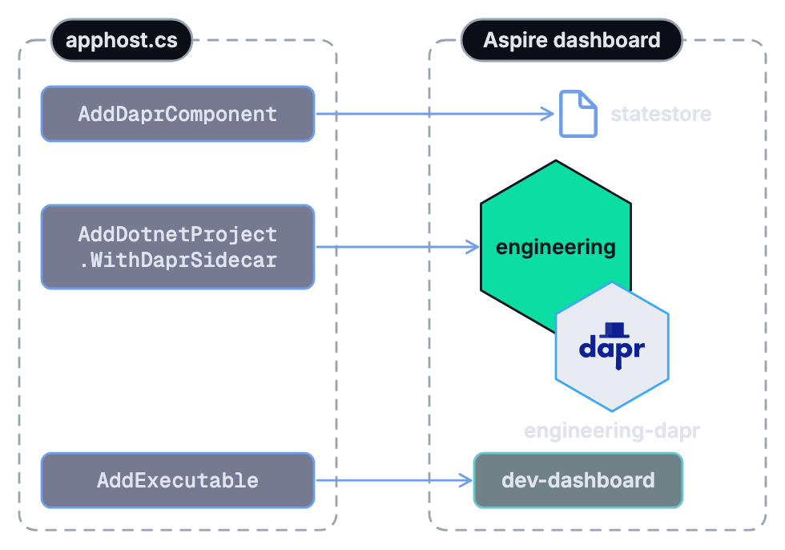

# Orchestrate with Aspire

In this lab, you'll describe the app in the AppHost, with its state store, its Dapr sidecar and the Dev Dashboard, and start it all with `aspire run`. This hands-on lab takes about 7 minutes to complete.

## 1. Describe the app in the AppHost

> [!IMPORTANT]
> This lab continues from the previous lab: it runs the `Engineering` project you wrote there.

The AppHost that `aspire new` created has no resources yet. The `Engineering` project needs three: the project itself, a Dapr sidecar that runs its workflow, and a state store where the sidecar saves the workflow history. You'll also add the Dev Dashboard, so you can look at the workflows in the next lab.

> [!IMPORTANT]
> When you use the *Run* button on a command, select the matching terminal from the dropdown that appears.

Use the **Aspire CLI** window to go to the `workflow-aspire` folder first:

```bash,run
cd /root/university-labs/workflow-aspire
```

Use the **Aspire CLI** window to replace `apphost.cs` with an AppHost that adds the resources:

```bash,run
cat > MeridianDiagnostics/apphost.cs <<'EOF'
#:package Aspire.Hosting.AppHost@17.0.0
#:package Aspire.Hosting.Dotnet@17.0.0
#:package CommunityToolkit.Aspire.Hosting.Dapr@13.0.0

using CommunityToolkit.Aspire.Hosting.Dapr;

var builder = DistributedApplication.CreateBuilder(args);

// The workflow state store: the Redis container that `dapr init` started.
var stateStore = builder.AddDaprComponent("statestore", "state.redis")
    .WithMetadata("redisHost", "localhost:6379")
    .WithMetadata("actorStateStore", "true");

builder.AddDotnetProject("engineering", "./Engineering/Engineering.csproj")
    .WithHttpEndpoint(port: 5411, name: "api")
    .WithDaprSidecar(sidecar => sidecar.WithReference(stateStore));

builder.AddExecutable("dev-dashboard", "diagrid-dev-dashboard", ".",
        "--port", "9090", "--bind", "0.0.0.0", "--no-open", "--mode", "aspire")
    .WithHttpEndpoint(port: 9090, isProxied: false);

builder.Build().Run();
EOF
```

The command writes the whole file, so running it again gives the same result. Open `MeridianDiagnostics/apphost.cs` in the **Editor** tab to see it. The next section explains what each part does.

## 2. What the AppHost adds

Each `Add...` call in `apphost.cs` adds a resource, and each resource shows up in the Aspire dashboard:



- **The Dapr integration.** The third `#:package` line adds `CommunityToolkit.Aspire.Hosting.Dapr`, the Dapr integration from the Aspire Community Toolkit. It brings `AddDaprComponent` and `WithDaprSidecar`. Version 13.0.0 works with Aspire 17.0.0.
- **The state store.** `AddDaprComponent("statestore", "state.redis")` adds a Dapr component named `statestore`, without a component YAML file. `redisHost` points it at `localhost:6379`, the `dapr_redis` container that `dapr init` started in this sandbox, so Aspire doesn't start a Redis of its own. Setting `actorStateStore` to `true` is required: Dapr workflows run on Dapr actors, and the sidecar only saves workflow history in a state store marked as the actor state store. Without it, every workflow call fails with an error that the state store is not configured to use the actor runtime. An in-memory store wouldn't work here: `AddDaprStateStore("statestore")` without this metadata creates an in-memory component, which isn't an actor state store, and it would lose the workflow history when the app stops. The next lab stops the app mid-run and relies on the history in Redis to resume it.
- **The project and its sidecar.** `AddDotnetProject("engineering", ...)` adds the `Engineering` project as the `engineering` resource. `WithHttpEndpoint(port: 5411, name: "api")` gives it a fixed port, so you can call it with curl in the next lab. `WithDaprSidecar` starts a Dapr sidecar next to the app, with `engineering` as its app ID, and `WithReference(stateStore)` gives the sidecar the `statestore` component. The sidecar uses the placement and scheduler services that `dapr init` started.
- **The Dev Dashboard.** `AddExecutable("dev-dashboard", ...)` runs a program as a resource, here the Diagrid Dev Dashboard that is installed in this sandbox. `--bind 0.0.0.0` lets the **Dev Dashboard** tab reach it on port 9090, `--no-open` stops it from opening a browser, and `--mode aspire` makes it show only the apps that Aspire runs. `WithHttpEndpoint(port: 9090, isProxied: false)` tells Aspire which port the Dev Dashboard listens on, so the Aspire dashboard shows its URL.

## 3. Start the app

Use the **Aspire CLI** window to go to the `workflow-aspire` folder:

```bash,run
cd /root/university-labs/workflow-aspire
```

Use the **Aspire CLI** window to start the AppHost:

```bash,run
aspire run --apphost MeridianDiagnostics/apphost.cs
```

`aspire run` builds the AppHost and starts every resource. `--apphost` tells it which AppHost to run. Without it, the CLI looks for one in the current folder, but only among the files that git tracks, and the workspace's `.gitignore` leaves out the `MeridianDiagnostics` folder. The first start takes a few seconds, because it builds the AppHost and the `Engineering` project. Once everything has started, the output ends with these lines (your log file has another name):

```text,nocopy
     AppHost:  MeridianDiagnostics/apphost.cs

   Dashboard:  http://localhost:17000

        Logs:  /root/.aspire/logs/cli_<timestamp>.log

               Press CTRL+C to stop the AppHost and exit.
```

> [!IMPORTANT]
> Leave `aspire run` running in the **Aspire CLI** window. The next lab uses the running app. Don't press `Ctrl+C` until the last lab tells you to.

## 4. Look around the dashboards

Open the **Aspire** tab. If it shows an error, select the tab's refresh button: the Aspire dashboard only started with `aspire run`. The **Resources** page lists these resources, each with the state `Running`:

- `engineering`, of type **Project**: the `Engineering` app. Its URLs are port 5411 and the port from the project's own `launchSettings.json`.
- `engineering-dapr-cli`, of type **Executable**: the process that runs the Dapr sidecar of `engineering`. Its URLs are the sidecar's ports.
- `dev-dashboard`, of type **Executable**: the Dev Dashboard, on port 9090.

The `statestore` component isn't in the list. Aspire hides some resources by default: `statestore` is one of them, and so is `engineering-dapr`, the resource that describes the sidecar. To see them, select the **View options** button (`...`) above the list and then **Show hidden resources**. The hidden resources appear with an eye-off icon, together with a few that Aspire uses for itself.

> [!WARNING]
> Don't select the URLs in the Aspire dashboard. They point at `localhost`, which opens on your own computer, outside the sandbox. Use the tabs instead: the **Aspire** tab for the Aspire dashboard and the **Dev Dashboard** tab for the Dev Dashboard.

Select **Console** in the menu on the left of the Aspire dashboard to read the output of a resource. Select `engineering-dapr-cli` in the resource list at the top of the page to see the sidecar's log lines.

Now open the **Dev Dashboard** tab. Until you ran `aspire run` it showed a connection error, because the Dev Dashboard is a resource of the AppHost and only runs while the AppHost runs. Select the tab's refresh button to load it. Its list of workflows stays empty until you start a diagnostics run in the next lab.

## 5. Check your work

The check below looks for the Dapr package and the `statestore`, `engineering` and `dev-dashboard` resources in `apphost.cs`, and then calls the `engineering` app on port 5411 and the Dev Dashboard on port 9090. If something is missing or doesn't answer, the message names the section to redo. The next lab uses the running app, so make sure the check passes before you continue.

<instruqt-task id="orchestrate"></instruqt-task>

---

You described the app in `apphost.cs`, with the `statestore` component on the `dapr_redis` container, the `engineering` project with its Dapr sidecar and the Dev Dashboard, and started it all with one `aspire run`.

## What's next?

In the next lab you'll start a diagnostics run with curl, follow it in the Dev Dashboard, and stop the `engineering` app in the middle of a run to see the workflow carry on where it left off. Keep `aspire run` running in the **Aspire CLI** window.
