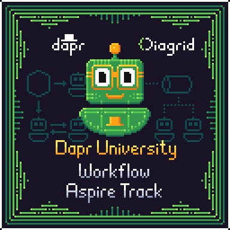

# Run and inspect

In this final lab, you'll start diagnostics runs with curl, follow them in the Dev Dashboard, and stop the `engineering` app in the middle of a run to see the workflow carry on where it left off. This hands-on lab takes about 8 minutes to complete. At the end of the lab, you can claim the Dapr University Holopin badge for this track.

## 1. Start a diagnostics run

> [!IMPORTANT]
> This lab continues from the previous lab: it uses the app that `aspire run` runs in the **Aspire CLI** window.

> [!IMPORTANT]
> When you use the *Run* button on a command, select the matching terminal from the dropdown that appears.

Open the **Aspire** tab and check that `engineering`, `engineering-dapr-cli` and `dev-dashboard` are `Running`. If they are, `aspire run` is still running in the **Aspire CLI** window. Skip the two commands below and go on to the **curl** window. Don't run anything in the **Aspire CLI** window, because it would type into the running `aspire run`.

**Only if `aspire run` is no longer running**, and the **Aspire CLI** window shows a prompt, start the app again. Use the **Aspire CLI** window to go to the `workflow-aspire` folder:

```bash,run
cd /root/university-labs/workflow-aspire
```

Then, still only if it wasn't running, use the **Aspire CLI** window to start the AppHost, and leave it running:

```bash,run
aspire run --apphost MeridianDiagnostics/apphost.cs
```

The pre-jump diagnostics for the next warp jump can now start. Use the **curl** window to go to the `workflow-aspire` folder:

```bash,run
cd /root/university-labs/workflow-aspire
```

Use the **curl** window to start a diagnostics run with the ID `jump-001`:

```bash,run
curl -s -X POST http://localhost:5411/start -H 'Content-Type: application/json' -d '{"id":"jump-001","starDate":"47634.4"}' | jq
```

The `/start` endpoint schedules a new `DiagnosticsWorkflow` instance with the ID you send and answers right away, without waiting for the workflow:

```json,nocopy
{
  "instanceId": "jump-001"
}
```

Each run needs an ID that isn't running yet. Starting `jump-001` again while it still runs fails with an error that an active workflow with that ID already exists. Once `jump-001` has completed, the same ID starts a new run that replaces the old one.

Use the **curl** window to ask for the status of the run:

```bash,run
curl -s http://localhost:5411/status/jump-001 | jq
```

For the first 15 seconds the workflow waits on its durable timer, so the status is still `Running`:

```json,nocopy
{
  "status": "Running",
  "output": null
}
```

Wait a few seconds and run the status command again. Once the run has completed, the output holds the result. Your readings, priority and summary differ, because the activities pick random readings:

```json,nocopy
{
  "status": "Completed",
  "output": {
    "starDate": "47634.4",
    "priority": "Urgent",
    "summary": "WarpCore=Degraded, LifeSupport=Degraded, Shields=Critical",
    "bridgeNotified": true
  }
}
```

`bridgeNotified` is only `true` when the priority is `Urgent`: for `Elevated` or `Routine` the workflow skips `NotifyBridgeActivity`.

## 2. Inspect the run in the Dev Dashboard

Open the **Dev Dashboard** tab and go to the **Workflows** page. It lists the `jump-001` instance of `DiagnosticsWorkflow`, with the status `Completed`. Select it to see its details:

- **Input and output.** The input is the ID and stardate that you sent to `/start`, and the output is the result that the status endpoint returned.
- **Event history.** Every step the sidecar saved, in order. `ExecutionStarted` comes first. Then three `TaskScheduled` events for `DiagnoseSubsystemActivity`, all at the same time: that's the fan-out. Their three `TaskCompleted` events follow, then a `TimerCreated` event and, about 15 seconds later, `TimerFired`. After that come `PrioritizeDiagnosticsActivity`, `NotifyBridgeActivity` when the priority was `Urgent`, and `ExecutionCompleted` at the end.

The Dev Dashboard reads all of this from the Redis state store, where the sidecar saved it.

You can also read the app's own log lines. In the **Aspire** tab, select **Console** in the menu on the left and select `engineering` in the resource list at the top of the page. You'll see `Starting diagnostics for stardate 47634.4`, a line with the reading of each subsystem, `Notifying the bridge` with the name of the officer when the run was urgent, and the `done` line with the priority.

## 3. Stop the app in the middle of a run

Now see what happens when the app stops while a workflow runs. You'll start a second run and stop `engineering` while the workflow waits on its 15 second timer, so read this section to the end before you start the run.

Use the **curl** window to go to the `workflow-aspire` folder:

```bash,run
cd /root/university-labs/workflow-aspire
```

Use the **curl** window to start a run with the ID `jump-002`:

```bash,run
curl -s -X POST http://localhost:5411/start -H 'Content-Type: application/json' -d '{"id":"jump-002","starDate":"47634.5"}' | jq
```

Right away, within 15 seconds, stop the `engineering` app: in the **Aspire** tab, go to the **Resources** page and select **Stop** in the **Actions** column of the `engineering` row. Its state changes to `Finished`. The `engineering-dapr-cli` row stays `Running`: only the app stops, and its Dapr sidecar keeps running.

If you prefer the command line, use the **curl** window to stop the `engineering` resource of the running AppHost instead:

```bash,run
aspire resource engineering stop --apphost MeridianDiagnostics/apphost.cs
```

Go to the **Workflows** page of the **Dev Dashboard** tab and select `jump-002`. It's still `Running`. Its **Event history** has the three `TaskCompleted` events of `DiagnoseSubsystemActivity` and a `TimerCreated` event, but no `TimerFired` and no `ExecutionCompleted`: the workflow stopped while it waited.

If `jump-002` already shows `Completed`, you stopped the app after the timer had fired. Start the app again as in section 4, then repeat this section with a new ID, such as `jump-003`: change the ID in the curl command before you run it, and use that ID in the rest of this lab.

## 4. Start the app again

Use the **curl** window to go to the `workflow-aspire` folder:

```bash,run
cd /root/university-labs/workflow-aspire
```

In the **Aspire** tab, select **Start** in the **Actions** column of the `engineering` row. After a few seconds its state is `Running` again.

If you prefer the command line, use the **curl** window to start the `engineering` resource instead:

```bash,run
aspire resource engineering start --apphost MeridianDiagnostics/apphost.cs
```

Don't start a new run. Use the **curl** window to ask for the status of `jump-002`:

```bash,run
curl -s http://localhost:5411/status/jump-002 | jq
```

The status is `Completed`, with the output of the run. If it's still `Running`, wait a few seconds and run the command again. The workflow carried on by itself as soon as the app was back. If the app was stopped for longer than the timer's 15 seconds, the timer was already due, so the run completes right after the restart.

Go back to `jump-002` on the **Workflows** page of the **Dev Dashboard** tab and look at its **Event history** again. There is still exactly one `TaskScheduled` event for each subsystem, all from before the stop. The new events come after them: `TimerFired`, `PrioritizeDiagnosticsActivity`, `NotifyBridgeActivity` when the priority was `Urgent`, and `ExecutionCompleted`.

## 5. What happened


- **The history survived the stop.** The sidecar saved each step of `jump-002` in the `statestore` component, the `dapr_redis` container, as it happened. Stopping `engineering` stopped only the app's process. The history, and the sidecar, stayed.
- **The timer is durable.** `context.CreateTimer` doesn't sleep inside the app. The sidecar saved the timer and the time it's due as the `TimerCreated` event. The timer became due in the sidecar, whether the app was running or not. The workflow processed `TimerFired` once the app had reconnected to its sidecar.
- **The workflow replayed, the activities didn't run again.** After the restart the `Dapr.Workflow` worker in `engineering` reconnected to the sidecar, and the sidecar sent it the history of `jump-002`. The worker ran the `DiagnosticsWorkflow` code again from the top against that history to rebuild where it was. This replay isn't special to a restart: the worker replays the workflow after every step, in `jump-001` too. The three `DiagnoseSubsystemActivity` calls returned their saved results instead of running again, so the readings didn't change. Then `PrioritizeDiagnosticsActivity` ran for the first time. The replay-safe logger didn't write `Starting diagnostics` a second time, even though that line of code ran again.

## 6. Check your work

The check below calls the `engineering` app on port 5411 and looks for a completed run among `jump-001` and `jump-002`. If the app doesn't answer, the message tells you how to start it again. If a run is still going, wait until it completes and check again.

<instruqt-task id="run_inspect"></instruqt-task>

---

You ran a Dapr workflow that Aspire started, followed every step of it in the Dev Dashboard, and saw it carry on from its last completed step after the app stopped in the middle of a run.

Here is what you did in this track:

1. **Create the solution:** you created a single-file Aspire AppHost with `aspire new` and added the `Engineering` web project with the `Dapr.Workflow` package.
2. **Write the workflow:** you wrote a workflow that checks three subsystems in parallel, waits on a durable timer, prioritizes the readings and notifies the bridge when it's urgent.
3. **Orchestrate with Aspire:** you described the app, its Dapr sidecar, the Redis state store and the Dev Dashboard in `apphost.cs`, and started them all with `aspire run`.
4. **Run and inspect:** you started diagnostics runs, read their history in the Dev Dashboard, and stopped the app in the middle of a run to see the workflow resume.

## Collect your badge & provide feedback

Congratulations! 🎉 You've completed the Dapr University Dapr Workflow with .NET Aspire learning track!

### Next steps

We have more opportunities for you to learn and share knowledge:

**Try another university track**
- [Dapr Workflow 101: durable execution, patterns and management](https://www.diagrid.io/university/dapr-workflow)
- [Make MAF agents reliable with Dapr Workflow](https://www.diagrid.io/university/ai-agents-maf)

**Try these Dapr tools**
- [Dapr Dev Dashboard](https://docs.diagrid.io/dapr-open-source/dapr-dev-dashboard/), a free & OSS companion tool for local Dapr development.
- [Dapr Ops Dashboard](https://docs.diagrid.io/dapr-open-source/dapr-ops-dashboard/), a free SaaS solution that automates the operational management of Dapr on Kubernetes.

**Join the community**
- Join the [Dapr Discord](https://diagrid.ws/dapr-discord) where thousands of developers share knowledge about Dapr. There are dedicated *#workflow*, *#agents* and language channels.
- Register for one of [our webinars](https://www.diagrid.io/webinars) to learn more about building reliable applications.

### Stop the app

Press `Ctrl+C` in the **Aspire CLI** window to stop `aspire run`. It stops the `engineering` app, its Dapr sidecar and the Dev Dashboard.

### Collect the badge

Collect the Dapr University badge for this track by following [this link to the Holopin platform](https://holopin.io/collect/TODO-workflow-aspire). You'll need a GitHub account to claim the badge. Then come back to this page, rate the track below, and click **Finish & Exit** to finish the lab.

<a href="https://holopin.io/collect/TODO-workflow-aspire"></a>

### Rate this track

Please rate this track so we can keep improving it 🚀.

<instruqt-feedback id="dapr-workflow-aspire-feedback"></instruqt-feedback>

<instruqt-completion text="You've completed Dapr Workflow with .NET Aspire!"></instruqt-completion>
